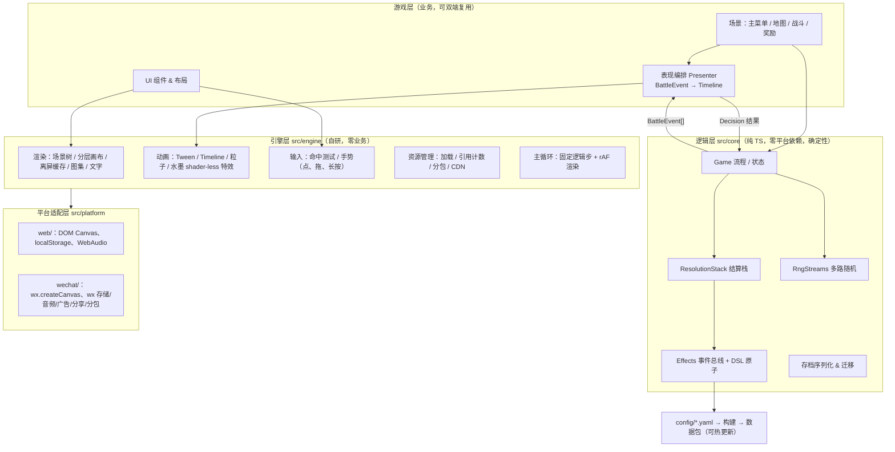
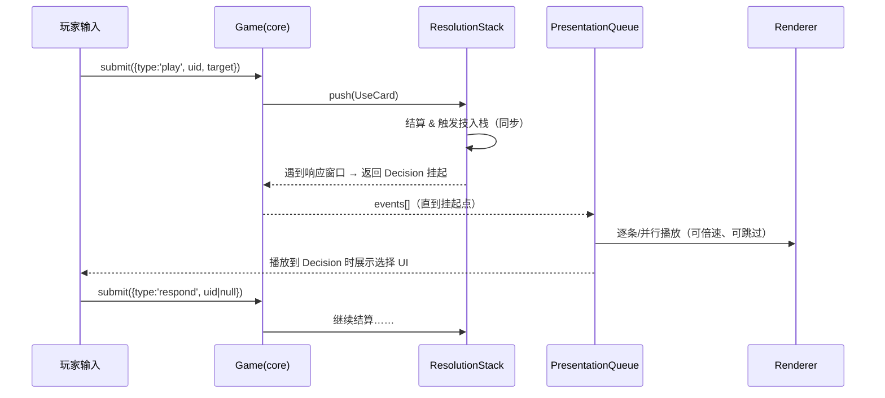
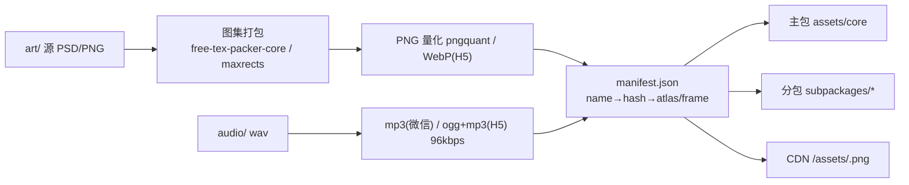
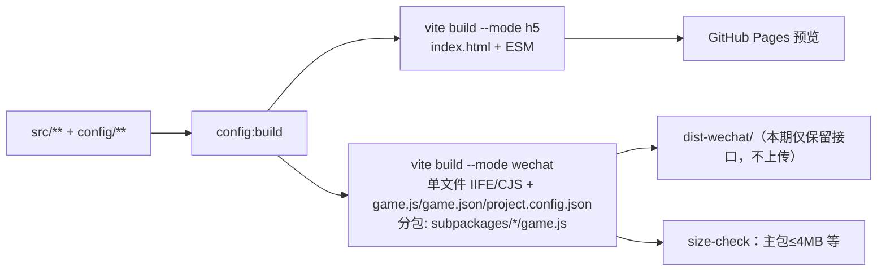
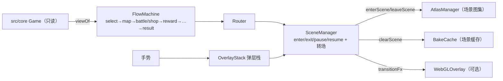
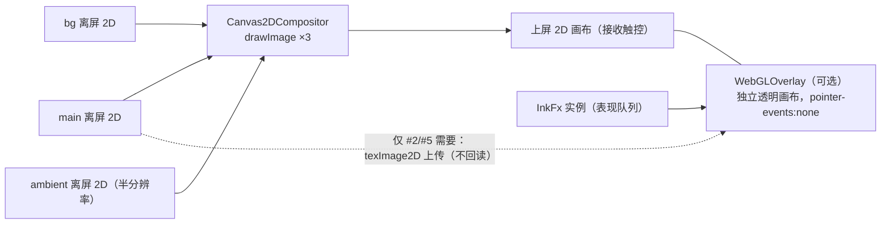

# 《墨卷三国》底层架构与引擎设计（草案 v0.6）

> 状态：已评审；关键取舍均已拍板（第 8 节）。仅文档，不含代码改动。
> 硬约束：**同一份 TypeScript 同时产出 H5 与微信小游戏**；**不使用游戏引擎**，以 Canvas 2D 绘制为主。
> v0.6 变更（P0，#32）：新增 §4.13 场景与页面流程框架；纹理内存对齐 render-spec §12（战斗峰值 22.4MB 压缩 / 35.7MB 无压缩；45MB 告警；1.5x 烘焙；LRU 上限；按场景加载图集；无 mipmap；特效 7 个 shader，纹理 0.63MB）；Pages 同时部署发布版（根目录）和调试版（`/debug/`）。
> v0.5 变更（P0，#32）：【已决定 2026-10-12】WebGL 改为**可选叠加层**：关闭时由 3 块 2D 画布**直接合成到上屏 2D 画布**，画面完整可玩，只是没有特效。开关：配置 + URL `?webgl=0|1`。自动降级延后到微信上线前。纹理内存预算 **≤50MB**（§4.7.1），取代 106MB 的假设；与 render-spec 的冲突待对齐。
> v0.4 变更：【已决定 2026-10-12】原第 8 节 9 项待拍板全部定案（见第 8 节）；新增 4.12 WebGL 水墨层（只走 WebGL，降级以后再做）；**先做 H5、以 H5 验收**，微信只保留接口。
> v0.3 变更：【已决定 2026-10-12】战斗页采用 **B 金漆屏风**，**单一皮肤、不做可切换皮肤**；render-spec 已随 PR #20 合入 main。
> v0.2 变更：①【已决定】战斗逻辑采用同步结算 + 事件流；②「战斗页表现需求」按 `docs/ui/render-spec.md`（已合入 main）重写，渲染分层与之对齐；③参考链接已逐条在线核验。
> 标注约定：【来源】为公开资料（附链接）；【推测】为无法从公开资料证实、基于经验的判断。

---

## 0. 结论摘要

1. **【已决定 2026-10-12，用户拍板】逻辑纯净、表现订阅**：`src/core` 改为“同步结算 + 产出事件流（BattleEvent[]）”，不再 `await io.sleep()`；表现层用**动画队列**消费事件。玩家输入只在明确的“决策点（Decision）”处挂起。这是可回放、可快进、可自动跑测、可双端复用的前提。用户明确：不考虑重构成本，优先正确性、性能与长期可扩展性，因此不再保留 async+sleep 方案。
2. **结算栈**：在现有 `Effects.emit` 之上引入显式 `ResolutionStack`（参考三国杀“结算/响应窗口”与杀戮尖塔 ActionManager 队列），解决嵌套响应（闪、无懈、判定改判）的顺序问题。
3. **自研轻量渲染层**：场景树承载 render-spec 的 16 个逻辑层（z0–z15）；物理上用 3 块 2D 离屏画布（背景 / 环境动效 30fps / 主画面），直接 2D 合成到上屏画布，另有可选的 WebGL 特效叠加画布；对象级“烘焙位图 + 每帧贴图合成”，静止时降帧到 0–10fps；脏矩形作为后备优化。
4. **平台适配层**仅一个接口 `Platform`，`web/` 与 `wechat/` 各实现一份；业务代码不得直接访问 `window`/`document`/`wx`。
5. **Vite 双目标构建**：`vite build --mode h5` 与 `--mode wechat`（library/iife 输出 + 生成 `game.js`/`game.json`/分包目录）。主包 ≤4MB 目标 ≤2.5MB。
6. **存档 = 种子 + 版本 + 决策日志 + 快照**，带迁移链；多路 RNG 流保证确定性回放。

---

## 1. 参考分析

### 1.1 杀戮尖塔（Slay the Spire）
| 方面 | 做法 | 依据 |
|---|---|---|
| 技术栈 | Java + libGDX，非 Unity | 游戏目录内 `desktop-1.0.jar` 是 ModTheSpire 的补丁对象（见下行仓库）；GDC 演讲 https://www.gdcvault.com/play/1025731/ （"'Slay the Spire': Metrics Driven Design and Balance"，讲的是数值与埋点，不是引擎）。“libGDX”依据模组社区资料，官方未单独声明，标【推测-高可信】 |
| 结算 | 全局 `GameActionManager` 维护 `actions` 队列，每帧 `update()` 推进当前 `AbstractGameAction`；卡牌 `use()` 只是 `addToBottom/addToTop` 入队，“插队”即栈语义 | 【来源】模组社区反编译文档 https://github.com/daviscook477/BaseMod/wiki 、https://github.com/kiooeht/ModTheSpire |
| 逻辑与表现 | **耦合**：Action 自带 `duration`，逻辑推进与动画时长绑在一起；VFX 走独立 `effectList`。这导致其快进、回放困难 | 【来源】同上 wiki；耦合导致的问题为【推测】 |
| 存档 | 每房间入口存档（`.autosave`，base64+异或混淆的 JSON），记录种子与各 RNG 流计数（`cardRng`/`monsterRng`/`eventRng`…）防 SL | 种子分享为游戏内公开功能；Fandom 页 https://slay-the-spire.fandom.com/wiki/Seeds 对抓取返回 403，内容未能核验；混淆格式与多 RNG 流字段名来自模组社区反编译，标【推测-高可信】 |
| 模组 | ModTheSpire 字节码补丁 + BaseMod 订阅钩子（`OnCardUseSubscriber` 等）；官方 Steam Workshop 支持 | 【来源】上述仓库 |
| 借鉴 | ✅ 动作队列/插队语义、多 RNG 流、种子分享；❌ 逻辑时长绑定动画 |

### 1.2 三国杀（OL / 移动版）与开源实现
| 方面 | 做法 | 依据 |
|---|---|---|
| 官方客户端 | 早期网页版基于 Flash；移动版技术栈未公开 | 均【推测】（未找到官方技术说明） |
| 规则结算 | “时机（Trigger）+ 结算（Use/Effect）+ 响应窗口（询问出闪/无懈）”模型，嵌套结算后入先出 | 【来源】官方规则集 & 开源复刻 太阳神三国杀 QSanguosha（Qt + Lua）https://github.com/Mogara/QSanguosha ，新月杀 FreeKill（Qt/QML + Lua）https://github.com/Qsgs-Fans/FreeKill |
| 架构 | 服务端权威 Room 线程跑结算，客户端只收“动画指令”（`doAnimate`/`log` 消息）——**天然逻辑表现分离** | 【来源】QSanguosha `src/server/room.cpp`、FreeKill `lua/server/` |
| 模组 | 技能/武将用 Lua 扩展包（`extensions/`），以“触发技 events + on_trigger + can_trigger”声明 | 【来源】FreeKill 文档 https://fkbook-all-in-one.readthedocs.io/ （已核验可访问） |
| 借鉴 | ✅ 触发技三段式（我们 `trigger/if/do` 已同构）、响应窗口、服务端/客户端式“事件指令流” |

### 1.3 卡厄思梦境（CHAOS ZERO NIGHTMARE，Smilegate，2025）
| 方面 | 做法 | 依据 |
|---|---|---|
| 技术栈 | Unity | 【推测】（未见官方说明） |
| 卡牌成长 | 战斗中“灵光一闪（Epiphany）”给卡追加变体，局内卡牌会被修改/复制/消灭，并通过“存档数据（Save Data）”上限约束局外保留 | 【来源】Smilegate 官方页 https://www.smilegate.com/en/game/chaoszeronightmare.do 、官方社区 https://page.onstove.com/chaoszeronightmare/EN ；存档点数规则见 Game8 攻略 https://game8.co/games/Chaos-Zero-Nightmare/archives/561104 （第三方）。本项目“灵光一闪/词条”即对标此机制 |
| 表现 | 2D Live 立绘 + 大量卡牌飞行/打击特效，演出可加速/跳过 | 【来源】公开试玩视频；实现方式【推测】为逻辑先算、表现队列播放 |
| 存档/模组 | 服务端存档（联网手游），无模组 | 【推测】 |
| 借鉴 | ✅ 卡实例（uid）级别的成长数据、演出倍速/跳过；需要逻辑与表现解耦才能做到 |

### 1.4 综合取舍
- 规则模型取三国杀（触发技 + 响应窗口 + 结算栈）；
- 执行模型取“**逻辑一次算完 → 事件流 → 表现队列**”（FreeKill 的 server/client 模式在单机内的同构），而非 StS 的“动作带时长”；
- 成长/存档取 StS 多 RNG 流 + CZN 卡实例数据。

---

## 2. 现状盘点（基于 main@3a72a46）

| 模块 | 现状 | 问题 |
|---|---|---|
| `src/core/battle.ts`（531 行） | `Game` 类，流程 + 状态；依赖 `BattleIO`（`log/update/sleep/showJudge/respond/epiphany/hurt/enemyHit/onBattleEnd`） | 逻辑内 `await io.sleep(300)` 等**把节奏写进逻辑**；`respond/epiphany` 是合理的决策点 |
| `src/core/effects.ts`（334 行） | `Effects`：`emit/emitSync/runAtom/stat/limit`，ATOMS 原子表 + COND 条件表，能力来自 `config/**.yaml` | 无显式结算栈，嵌套靠 async 调用栈；原子直接 `g.log` 文本，表现只能拿到字符串 |
| `src/core/rng.ts` | mulberry32 单流 `Rng` | 单流：任何表现层/UI 调用 rng 都会破坏回放；无状态序列化 |
| `config/` + `scripts/build-config.ts` | YAML + JSON Schema，构建生成 `src/data/config` | 适合作为热更新载体；需加 `configVersion` |
| `src/platform/web/main.ts`（431 行） | DOM 实现 BattleIO | 将被 Canvas 渲染替换，可保留为调试面板 |
| `src/platform/wechat/` | 仅 README | 待实现 |
| `src/sim/autoplay.ts` | 自动对局 | 很好的回放/回归基础 |
| CI | config:check + lint + test + build；Pages 部署 | 需加 wechat 目标构建与包体检查 |

---

## 3. 分层架构



依赖规则（用 ESLint `no-restricted-imports` 强制）：`core` 不得 import `engine/platform/game`；`engine` 不得 import `core/game`；只有 `platform/*/entry.ts` 可以 import 具体平台实现。

### 3.1 逻辑 → 表现 时序



---

## 4. 模块设计与接口

### 4.1 平台适配层（需求 1）

```ts
// src/platform/types.ts
export interface Platform {
  readonly name: 'web' | 'wechat';
  /** 主画布（微信首次 createCanvas 为上屏画布） */
  mainCanvas(): HTMLCanvasElement | WechatMinigame.Canvas;
  createOffscreen(w: number, h: number): CanvasLike;
  createImage(): ImageLike;
  systemInfo(): { width: number; height: number; dpr: number; safeArea: Rect; platform: 'ios' | 'android' | 'devtools' | 'pc'; benchmarkLevel?: number };
  onTouch(h: { start(t: TouchPoint[]): void; move(t: TouchPoint[]): void; end(t: TouchPoint[]): void; cancel(t: TouchPoint[]): void }): void;
  onShow(cb: () => void): void;
  onHide(cb: () => void): void;
  raf(cb: (t: number) => void): number;
  audio: AudioAdapter;
  storage: StorageAdapter;
  ads: AdsAdapter;
  share: ShareAdapter;
  loader: SubpackageLoader;
  http(req: { url: string; method?: 'GET' | 'POST'; data?: unknown; responseType?: 'text' | 'arraybuffer' }): Promise<{ status: number; data: unknown }>;
  fs?: { download(url: string): Promise<string /* localPath */>; exists(p: string): boolean }; // 仅微信，CDN 缓存
  reportError(e: ErrorReport): void;
  vibrate?(kind: 'light' | 'medium' | 'heavy'): void;
}
export interface AudioAdapter {
  playBgm(key: string, opt?: { loop?: boolean; volume?: number; fadeMs?: number }): void;
  playSfx(key: string, opt?: { volume?: number }): void; // 内部做实例池（微信 InnerAudioContext 数量有限）
  stopBgm(fadeMs?: number): void;
  setMuted(m: boolean): void;
}
export interface StorageAdapter {
  get(key: string): string | null;
  set(key: string, v: string): void; // 微信单 key ≤1MB、总量 ≤10MB【来源】wx.setStorageSync 文档
  remove(key: string): void;
}
export interface AdsAdapter {
  rewarded(placement: string): Promise<'completed' | 'skipped' | 'unavailable'>;
  interstitial?(placement: string): Promise<void>;
}
export interface ShareAdapter {
  share(p: { title: string; imageUrl?: string; query?: string }): Promise<boolean>;
  onShareQuery(cb: (q: Record<string, string>) => void): void; // 种子分享入口
}
export interface SubpackageLoader {
  load(name: string, onProgress?: (p: number) => void): Promise<void>; // 微信 wx.loadSubpackage；H5 = 动态 import + 资源预取
}
```

- 微信 Canvas：首个 `wx.createCanvas()` 为上屏画布，后续为离屏【来源】https://developers.weixin.qq.com/minigame/dev/api/render/canvas/wx.createCanvas.html
- H5 广告【已决定】：H5 不接广告，“看广告刷新”改为**每局免费 1 次**（`AdsAdapter.rewarded` 在 H5 上按局计数，第 1 次返回 `completed`，之后返回 `unavailable`）。

### 4.2 轻量渲染层（需求 2）

```ts
// src/engine/render
export abstract class Node {
  x = 0; y = 0; scaleX = 1; scaleY = 1; rotation = 0; alpha = 1; visible = true; zIndex = 0;
  anchorX = 0; anchorY = 0;
  parent: Node | null = null; readonly children: Node[] = [];
  /** 静态子树缓存为离屏位图，内容变化时 markDirty() */
  cacheAsBitmap = false;
  interactive = false;
  add(c: Node): this; remove(c: Node): void;
  markDirty(): void;
  localBounds(): Rect;
  abstract draw(ctx: CanvasRenderingContext2D): void;
}
export class Sprite extends Node { frame: AtlasFrame | null; nineSlice?: Insets; tint?: string }
export class BitmapText extends Node { text: string; font: string; tint?: string }
export class Text extends Node { text: string; style: TextStyle; maxWidth?: number; /** 内部缓存为位图，文本/样式变才重排 */ }
export class Graphics extends Node { /* 矢量命令录制 */ }
export class Layer extends Node { readonly canvas: CanvasLike; mode: 'static-dirty-rect' | 'full-redraw' }

export interface Renderer {
  readonly dpr: number;
  readonly design: { width: 390; height: 844 };
  readonly safe: Rect;           // 设计坐标系下的安全区
  readonly capsule: Rect | null; // 微信胶囊禁区（H5 为 null）
  /** 2D 离屏画布：bg（章节/尺寸变化才重建）、ambient（半分辨率，30fps）、main（z2–z15）；由 Canvas2DCompositor 直接合成到上屏 2D 画布 */
  surfaces: { bg: Layer; ambient: Layer; main: Layer };
  /** 逻辑层 z0–z15，见 4.5 */
  layer(z: number): Node;
  frame(dt: number): void;
  /** 无动画、无拖拽、无常驻循环时返回 false，主循环降到 0fps */
  needsFrame(): boolean;
  stats(): { drawCalls: number; dirtyLayers: number; ms: number };
}
export interface Atlas { get(name: string): AtlasFrame; readonly image: ImageLike }
export interface TextStyle { font: string; size: number; color: string; stroke?: { color: string; width: number }; lineHeight?: number; align?: 'left' | 'center' | 'right'; vertical?: boolean /* 竖排卷轴文字 */ }
```

关键策略：
- **逻辑层 vs 物理画布**（与 render-spec 对齐，取代 v0.1 的 4 画布方案）：16 个逻辑层只是场景树中按 z 排序的容器节点，不各占一块 canvas。16 块全屏离屏在 dpr=3 时显存约 16×390×844×9×4B≈190MB，不可接受。物理上只用 3 块：bg（z0）、ambient（z1，30fps，低画质关闭）、main（z2–z15 每帧合成）。
- **对象级缓存**：敌人、我方、徽章、每张手牌、详情浮层各烘焙一张位图（`cacheAsBitmap`），内容变了才重烘，每帧只做带变换的 `drawImage`。受击闪白、溶解用 `globalCompositeOperation` 叠加，不重烘。
- **脏矩形**：先不实现。缓存到位后整屏贴图合成的开销可以接受；基准不达标时再给 main 加脏矩形（合并成 ≤4 个矩形，超过就整屏重画）。
- **降帧**：静止时 0fps；只剩常驻循环（致命脉冲、墨角标呼吸、倒计时）时 10–30fps；有动画或拖拽时 60fps。
- **高 DPR**：与 render-spec 对齐，渲染缓冲 = 逻辑 × min(dpr, 3)，低端设备**自动降低 DPR**（2 或 1.5）【已决定】；`ctx.setTransform(scale…)` 统一处理；资源按 2x 出图，3x 屏线性过滤。
- **适配**：设计基准 **390×844 dp** 竖屏（锁竖屏），等宽缩放 `scale = screenW/390`，多出或缺少的高度由战场区弹性吸收；背景层 cover 铺满物理屏，其余层只放在安全区内；`safeArea` 来自 `wx.getWindowInfo()` / CSS `env(safe-area-inset-*)`，胶囊用 `wx.getMenuButtonBoundingClientRect()` 生成禁区；布局提供 `anchor: 'safe-top' | 'safe-bottom' | 'capsule-left'`。
- **文字**（按 render-spec 4.1）分三类：①书法字（马善政楷书，OFL）按用到的字做子集（约 300 字、60–90KB），H5 用 FontFace、微信用 `wx.loadFont`，常用的卡名、武将名、按钮**预渲染进图集**，避免首帧闪烁；②数字用**位图字体**（`BitmapText`，2 套）；③说明文字用系统无衬线字体，不打包。所有 `Text` 节点都离屏缓存。
- 上屏画布是 **2D**，三块离屏画布直接 drawImage 合成；WebGL 只是**可选的特效叠加画布**（独立画布，叠在上方），见 4.12【已决定】。

### 4.3 UI 组件、布局、命中测试与手势（需求 3）

```ts
export interface Layout { width?: number | `${number}%`; height?: number | `${number}%`; anchor?: Anchor; margin?: Insets; direction?: 'row' | 'column'; gap?: number; justify?: 'start' | 'center' | 'end' | 'space-between'; }
export class Widget extends Node { layout: Layout; enabled: boolean; on(ev: 'tap' | 'longpress' | 'dragstart' | 'dragmove' | 'dragend', h: (e: GestureEvent) => void): this; }
export class Button extends Widget {}
export class Panel extends Widget {}      // 九宫格背景
export class ScrollView extends Widget {} // 惯性 + 裁剪
export class Modal extends Widget {}      // 遮罩、吞事件
export class CardView extends Widget { bind(card: CardViewModel): void }
export class HandFan extends Widget { /* 扇形手牌布局，可挤压 */ }

export interface GestureConfig { tapMaxMove: 8; longPressMs: 420; dragThreshold: 8; dragFollowLerp: 0.35; primaryPointerOnly: true }
export interface GestureEvent { kind: string; x: number; y: number; target: Widget; dropTarget?: Widget }
export interface HitTester { pick(x: number, y: number): Widget | null; /* 逆 zIndex 遍历，支持 hitArea 扩展与 alpha 不检测 */ }
```

- 命中测试：基于场景树逆序 + 局部坐标逆变换 + 矩形/多边形 `hitArea`；手牌重叠时取最上层，允许“最小触控尺寸 88 设计像素”扩展。
- 拖拽出牌：`dragstart` 抬起放大 → 拖动中实时询问 `logic.legalTargets(uid)` 高亮可落目标 → `dragend` 落在目标/出牌区则 `submit(play)`，否则弹回。逻辑只接收最终意图。
- 长按详情：420ms 未移动触发（期间显示 0–420ms 环形进度） `longpress`，显示卡牌/词条/状态详情浮层；松手关闭；拖拽开始则取消长按。
- 输入锁：表现队列播放“阻塞型”动画时，只允许倍速/跳过手势。

### 4.4 动画、粒子、水墨特效与表现队列（需求 4）

逻辑事件（替代现在的 `log` 字符串 + `sleep`）：

```ts
// src/core/events.ts
export type BattleEvent =
  | { t: 'draw'; uids: number[] }
  | { t: 'discard'; uids: number[]; reason: 'play' | 'turn_end' | 'effect' }
  | { t: 'play'; uid: number; target?: number }
  | { t: 'damage'; target: EntityRef; amount: number; absorbed: number; element: 'normal' | 'fire'; killed: boolean }
  | { t: 'heal'; target: EntityRef; amount: number }
  | { t: 'armor'; target: EntityRef; delta: number }
  | { t: 'dodge'; target: EntityRef; by: 'mark' | 'card' }
  | { t: 'judge'; reason: string; card: CardSnap; ok: boolean }
  | { t: 'ability'; abilityId: string; owner: EntityRef } // 技能发动横幅
  | { t: 'status'; target: EntityRef; status: string; value: number }
  | { t: 'intent'; enemy: number; acts: string[] }
  | { t: 'affix_gain'; uid: number; affixId: string }      // 灵光一闪
  | { t: 'phase'; phase: 'player_turn' | 'enemy_turn' | 'battle_end'; win?: boolean }
  | { t: 'log'; text: string };                            // 兼容现有日志
export type EntityRef = 'player' | { enemy: number };

export type Decision =
  | { kind: 'main'; legal: LegalActions }                  // 出牌阶段
  | { kind: 'respond'; prompt: string; legalUids: number[]; timed: boolean }
  | { kind: 'epiphany'; uid: number; options: string[]; canReroll: boolean };

export interface StepResult { events: BattleEvent[]; decision: Decision | null; state: BattleSnapshot }
export interface BattleLogic {
  start(seed: string, setup: RunSetup): StepResult;
  submit(input: PlayerInput): StepResult;   // 同步、确定性
  legalTargets(uid: number): EntityRef[];
  snapshot(): BattleSnapshot;
}

// src/engine/anim
export type Easing = (t: number) => number; // linear, quadOut, cubicInOut, backOut, elasticOut, inkBleed(自定义)
export interface Tween { to(target: object, props: Record<string, number>, ms: number, ease?: Easing): Tween; then(f: () => void): Tween }
export interface Timeline { seq(...steps: Step[]): Step; par(...steps: Step[]): Step; wait(ms: number): Step; call(f: () => void): Step }
export interface PresentationQueue {
  enqueue(events: BattleEvent[]): void;
  /** 事件 → 动画剧本：注册表，按事件类型可配置 */
  register<T extends BattleEvent['t']>(t: T, director: (e: Extract<BattleEvent, { t: T }>, ctx: PresentCtx) => Step): void;
  speed: 1 | 1.5 | 2; skip(): void;        // 与 render-spec 一致；跳过时直接应用最终 snapshot
  readonly idle: boolean;
  onDrained(cb: () => void): void;
}
export type Quality = 'low' | 'mid' | 'high'; // 低：关环境/流光/粒子；中：粒子减半
export interface ParticleEmitter { emit(cfg: ParticleConfig, at: Vec2): void } // 对象池，单层上限 300 粒
```

- 原则：**视图状态由 snapshot 兜底**——每批事件后附带 snapshot，动画结束（或跳过）时视图对齐 snapshot，避免累积误差。
- 水墨特效：墨晕、晕染、纸纹、泼墨转场走 WebGL（4.12）；墨点飞溅、纸屑等仍用 2D 粒子。表现队列把效果实例（`InkFx`）交给 GL 合成器。
- 合并规则：同帧多条 `damage` 可并行；`ability` 横幅串行；`log` 不占时长。

### 4.5 战斗页表现需求（对齐 main 上的 docs/ui/render-spec.md，PR #20 已合并）

> 规格的权威来源是 render-spec，本节只把它映射到引擎能力。
> **【已决定 2026-10-12】采用 B 金漆屏风，单一皮肤**。下文提到 A 的内容只作对照，**不实现**。引擎不做皮肤切换机制，B 的布局、剧本和资源直接作为唯一实现（参数仍放配置，方便调数值）。
>
> **B 方向对引擎的专项需求**：①九宫格牌框（`Sprite.nineSlice`），先烘焙进每个敌人或卡牌的缓存，避免每帧拼接；②手牌平铺重叠（72×104，步进 58），超过 7 张时横向拖动滚动，加手势方向锁（水平是滚动、向上是出牌）；③行动倒计时圈动画（弧线转动 + 数字翻牌，250ms）；④中央判定区（翻牌 + 结果印），短屏时判定区并入 Boss 牌右侧；⑤纯色遮罩 α.72；⑥金光高亮、金尘环境动效。

#### 4.5.1 16 个逻辑层 → 引擎映射

| z | 层 | 物理画布 | 缓存/重绘策略（引擎能力） |
|---|---|---|---|
| 0 | 背景 | bg 离屏（物理分辨率） | 切章节、改尺寸时重建；按 cover 铺满物理屏；A 的晕染、纸纹等滤镜**烘焙成贴图**；A 的视差可拆成 2 张离屏（`ParallaxLayer`） |
| 1 | 环境动效 | ambient 离屏 | 30fps 单独节拍（`Layer.fps=30`），低画质关闭 |
| 2–3 | 敌人后/前排 | main | 每个敌人一张烘焙位图；后排缩放、去饱和、半透明用变换和 `filter`/预烘焙实现（微信端 `ctx.filter` 不保证可用，**去饱和要预烘焙**）；受击闪白、溶解用混合模式叠加 |
| 4 | 敌人附件 | main | 每个徽章一张小位图，数值变化时置脏重烘 |
| 5 | 判定区 | main | 事件驱动的 Timeline，位置由布局配置决定（A 在右侧，B 在中央） |
| 6–7 | 我方 / 资源 | main | 立绘或武将牌烘焙；体力、护甲、军令徽章单独缓存 |
| 8 | 底栏 | main | 烘焙；数字用 BitmapText 局部更新；背景向下延伸到物理屏底 |
| 9 | 手牌 | main | 每张卡一张位图（牌框、插画、书法名、费用、花色、墨角标），状态变化时重烘；每帧只做变换；流光走叠加层 |
| 10 | 遮罩 | main | 每帧画；径向渐变（A）或纯色（B）由参数决定 |
| 11 | 焦点层 | main | **引擎能力 `Node.promote()`**：把节点的缓存位图在遮罩上方再画一次，节点本身不移动，命中测试也提到这一层 |
| 12 | 响应 UI | main | 每帧画：贝塞尔指向线、环形或条形倒计时 |
| 13 | 飘字/特效 | main | 每帧画；粒子池；画质分档 |
| 14 | 详情浮层 | main | 打开时烘焙一次 |
| 15 | 系统层 | main | Toast、引导、断线提示，事件驱动 |

结论：16 层是**逻辑 z 序**，物理只有 bg、ambient、main 3 块画布（v0.1 的 4 画布方案作废）。场景树里每个 z 是一个容器节点，引擎规定**同 z 内按 zIndex 排序，跨 z 一律按 z 值排序**。

#### 4.5.2 适配与安全区
- 等宽缩放 `scale = screenW/390`，多出或缺少的高度由**弹性区**（z0–z5 的战场区）吸收。布局系统提供 `flexRegion` 和 `anchor: safe-top / safe-bottom / capsule-left`。
- 胶囊避让：平台层给出 `capsule` 禁区，顶部条的布局求解时把它排除掉；设置按钮放在胶囊左侧（具体放法待对齐）。
- 屏幕比例断点：大于 2.1 时敌人行距最多 +24dp；小于 1.9 时后排缩到 .66、立绘裁切（A）或判定区合并（B）。引擎提供**按宽高比切换的布局变体**（`layoutVariants: { ratio: [min,max], overrides }`）。
- 锁定竖屏：微信在 `game.json` 里设 `deviceOrientation: portrait`；H5 横屏时显示提示层。

#### 4.5.3 交互 → 手势与命中测试
| render-spec 行为 | 引擎能力 |
|---|---|
| 点卡选中（上浮 22–26dp、放大 1.08–1.12），合法目标高亮，非法目标 α.35 | `tap` + 逻辑 `legalTargets(uid)` + Tween；高亮效果（描边光或金光）作为可配置的 `HighlightStyle` |
| 点非法目标时卡牌抖动 ±4dp/160ms | 内置 `shake` 预设 |
| 热区 = 剪影或牌框外扩 8dp | `hitArea` 支持外扩（`hitPadding`）；剪影用多边形或 alpha 位图做命中 |
| 移动超过 8dp 进入拖拽，跟手插值 0.35，墨线贝塞尔箭头，悬停合法目标时放大 1.05 并吸附 | `dragThreshold=8`、`dragFollowLerp=0.35`；`dropTargets` 在悬停时回调；`BezierArrow` 节点 |
| 拖回手牌区（y > 手牌区顶部−20）取消；无目标牌拖过出牌线（手牌区顶部上方 60dp）即生效 | 布局里可配置**命名区域线**（`zones.cancel`、`zones.playLine`） |
| 长按 ≥420ms 弹详情，带 0–420ms 环形进度；松手不出牌；点任意处关闭 | `longPressMs=420` 并持续发 `longpressprogress`；长按后**取消**接下来的 tap 和 drop |
| 军令不足：费用抖动、资源闪红，不进入选中态 | 逻辑返回 `illegalReason`，表现层按原因播剧本 |
| 结束回合二次确认（1.5s） | Button 状态机组件 |
| 响应窗口只允许合法牌和“承受”交互；倒计时 5/8/12s 超时自动承受；开了自动出闪且只有 1 张合法牌时自动打出并提示 0.6s | `InputScope`（模态输入白名单）+ Decision `respond{timed}`；**倒计时由表现层计时，超时时提交 `respond(null)`**，逻辑不感知真实时间，保证可回放；自动出闪由表现层代为提交，并写进输入日志 |
| 手牌超过 7 张：A 压缩扇角，B 横向滚动；初始方向区分滚动和出牌 | `HandLayout` 策略接口（`fan` / `row-scroll`）+ 手势**方向锁定**（水平滚动、向上拖拽） |
| 只认第一指 | `primaryPointerOnly` |

#### 4.5.4 动画清单 → 表现队列
倍速统一为 1x/1.5x/2x（时长除以倍速）。“可跳过”= 点屏后直接对齐到 snapshot 终态。引擎为每个剧本登记三个标志：`scalable`（受倍速影响）、`skippable`（可跳过）、`blocking`（阻塞队列）。

| # | 动画 | 1x 时长 | 倍速 | 跳过 | 引擎归类 |
|---|---|---|---|---|---|
| 1 | 出牌飞行 | 250ms | ✓ | ✓ | 阻塞 Tween |
| 2 | 墨晕命中 | 400ms | ✓ | ✓ | 噪声遮罩贴图 + `destination-in`/`out` 合成 |
| 3 | 朱砂溅 | 500ms | ✓ | ✓ | 粒子 6–10 个 |
| 4 | 纸屑 | 700ms | ✓ | ✓ | 位图切片粒子 12–20 片 + 溶解 |
| 5 | 伤害飘字 | 700ms | ✓ | 不阻塞 | 非阻塞轨道（`par` 到全局 fx 轨） |
| 6 | 受伤红闪 + 震屏 | 250ms | ✓ | 不阻塞，可关 | 相机 shake + 晕影；设置开关 |
| 7 | 护甲吸收 / 破甲 | 300/500ms | ✓ | ✓ | Tween / 碎片粒子 |
| 8 | 获得护甲 | 300ms | ✓ | ✓ | backOut 缓动 + 数字滚动（`NumberRoll`） |
| 9 | 体力变化 | 400ms | ✓ | ✓ | B：勾玉熄灭/点亮 |
| 10 | 意图出现/变化 | 250ms | ✓ | ✓ | backOut |
| 11 | 致命意图脉冲 | 1.2s 循环 | ✗ | 常驻 | **常驻循环轨**（不进事件队列，按真实时间跑） |
| 12 | 敌人行动前冲 | 350ms | ✓ | ✓ | 阻塞 |
| 13 | 行动倒计时减 1（仅 B） | 250ms | ✓ | ✓ | 仅 B |
| 14 | 判定翻牌 | 650ms（200+300+150） | ✓ | ✓ | `seq`；绕 Y 轴翻面用 scaleX 模拟 |
| 15 | 抽牌 | 每张 220ms，间隔 60ms | ✓ | ✓ | `stagger` |
| 16 | 弃牌 | 300ms | ✓ | ✓ | 阻塞 |
| 17 | 灵光一闪就绪 | 2.4s 循环 | ✗ | 常驻，低画质关流光 | 常驻循环轨 + 叠加层 |
| 18 | 灵光一闪触发 | 900ms | ✓ | ✓ | 阻塞 |
| 19 | 响应弹出 | 250ms | ✓ | ✗（需要操作） | 结束后进入 Decision |
| 20 | 响应倒计时 | 5/8/12s | ✗ | ✗ | 真实时间计时器（不受倍速影响） |
| 21 | 军令消耗 | 200ms | ✓ | ✓ | 非阻塞 |
| 22 | 回合开始横幅 | 600ms | ✓ | ✓（可关） | 阻塞，设置开关 |
| 23 | 背景环境 | 循环 | ✗ | 常驻，低画质关 | ambient 层 |

由此得出引擎需要的能力：**3 类时间轴**（事件队列轨，受倍速和跳过影响；常驻循环轨，用真实时间；交互计时器，用真实时间，不受倍速影响）；`stagger`；数字滚动；遮罩合成；位图切片碎裂；画质分档 `Quality`（低档关环境、流光和粒子；中档粒子减半）。

```ts
export interface DirectorMeta { scalable: boolean; skippable: boolean; blocking: boolean; quality?: Quality /* 低于此档不播 */; setting?: string /* 设置开关 key */ }
export interface PresentationQueue {
  register<T extends BattleEvent['t']>(t: T, meta: DirectorMeta, director: (e: Extract<BattleEvent, { t: T }>, ctx: PresentCtx) => Step): void;
  loops: { add(id: string, step: Step, quality?: Quality): void; remove(id: string): void }; // 常驻循环轨
}
```

#### 4.5.5 资源与包体
- render-spec §9（B 定稿，PR #29）估算压缩后合计**约 2.5MB**：UI 400KB、特效 150KB、卡图 600KB、武将 480KB、敌人 550KB、背景 200KB、字体 80KB。首包约 **1.1MB**（ui_common、fx、字体、共享背景、第一章敌人），立绘、卡图和第 2/3 章敌人走分包。另有 WebGL 特效纹理约 0.7MB，放在 `fx_webgl` 分包（4.12.4）。H5 阶段“分包”对应按需加载的资源组。加上代码约 0.8MB，首包约 1.9MB。
- 图集单张 ≤2048：`battle_ui`（2048）、`battle_fx`（1024）、`cards_art_{1,2}`（1024）；立绘和敌人按章节动态加载。资源管线（4.7）按这些分组输出 manifest 的 group。
- 单一 B 皮肤：只打包 B 的资源；九宫格切线按 render-spec §10（框 24/24/24/24、按钮 16、面板 20，2x）写进图集 JSON 的 `slice` 字段。
- 离屏缓存上限：卡 10、敌 6、徽章约 30，约 12MB@dpr2。引擎提供 `BitmapCachePool`，设上限并按 LRU 淘汰，切换战斗时清空。

#### 4.5.6 仍待对齐
- 设置按钮的具体位置（放胶囊左侧，还是改为左上菜单），待对齐。
- B 方向各动画剧本的细节参数，以 render-spec 和 mockups-v2 为准，实现时逐项对稿。

#### 4.5.7 给 UI 设计的引擎硬约束
1. **滤镜和混合**：
   - **WebGL 路径**（render-spec §11 的 13 项，清单待对齐）：由 shader 实现，UI 提供参数和噪声/笔刷贴图，不需要序列帧；同屏特效实例 ≤8；全屏特效 pass 同时 ≤2；纹理放 `fx_webgl` 分包（约 0.7MB）；特效不承载关键信息，也不阻塞。
   - **2D 场景层**（卡牌、敌人、UI）：仍不能用 `ctx.filter`、`shadowBlur`、SVG 滤镜；去饱和、阴影、发光要预烘焙；只允许 `globalAlpha`、tint 和 `source-over / lighter / multiply / destination-in / destination-out`。
   - WebGL 是可选叠加层：关闭（`?webgl=0`、配置关闭或设备不支持）时 2D 画面完整可玩，只是没有这些特效；**不做 2D 替代特效**。自动降级延后到微信上线前。
2. **字体**：书法字体只用一种（马善政楷书，OFL），按用到的字做子集，≤90KB；固定文案优先烘焙进图集。数字只用位图字体（最多 2 套）。说明文字用系统无衬线字体。不使用其他可商用风险字体。
3. **包体**：微信主包 ≤4MB（硬限），工程目标 ≤2.5MB，其中首包资源 ≤1.2MB（render-spec 现为约 1.1MB；WebGL 纹理约 0.7MB 放独立分包）。总包按 20MB 保守计算（官方另一处写 30MB）。独立分包 ≤4MB。其余资源走分包或 CDN。
4. **DPR 和分辨率**：设计基准 390×844 dp，DPR 上限 3，资源按 2x 出图；低端设备自动降到 2 或 1.5【已决定】。
5. **图集**：单张 ≤2048×2048，按场景分组，资源尺寸尽量用 2 的幂或便于装箱的尺寸。牌框用九宫格并标注切线。
6. **性能**：低端安卓稳定 60fps；每帧 drawImage ≤300 次、粒子 ≤300 个；同屏全屏半透明遮罩 ≤2 层；静止时 0fps，常驻循环动效要少。
7. **内存**：纹理总计 **≤50MB**，超过 45MB 告警，按 render-spec §12 落地（见 §4.7.1）：战斗峰值 22.4MB（压缩）/ 35.7MB（无压缩）；缓存低端 1.5x、LRU 上限、只缓存在屏对象；图集按场景加载；无 mipmap。WebGL 关闭时 2D 路径的 RGBA8 解码问题待对齐（§4.7.1 第 2 条），战斗缓存约 12MB@dpr2（卡 10、敌 6、徽章 30）；立绘和敌人按章节加载、离开时释放。
8. **动画时间轴**：每项动画必须标明时长（1x），以及是否受倍速影响（1x/1.5x/2x）、能否跳过、是否阻塞。跳过时直接对齐终态，所以动画不能带逻辑副作用。常驻循环和倒计时按真实时间运行，不受倍速影响。画质低档会关闭环境动效、流光和粒子，中档粒子减半，设计时不能依赖这些效果传达信息。

### 4.6 性能预算（需求 5）

| 项 | 预算 | 说明 |
|---|---|---|
| 帧率 | 本期以 **H5 中端设备 60fps** 验收；预算按约 3 年前、千元左右的安卓机（约骁龙 680 / Helio G85 档，见 render-spec §11）制定，**低端真机验收延后**，真机待定 | `wx.getDeviceBenchmarkInfo` / `benchmarkLevel` 分档【来源】https://developers.weixin.qq.com/minigame/dev/api/base/system/wx.getDeviceBenchmarkInfo.html |
| 单帧 | 逻辑 ≤1ms（仅输入时），渲染 ≤8ms，余量给 GC/系统 | |
| 每帧 drawImage | ≤300；粒子 ≤300；离屏层 ≤6 张 | 【推测】经验值，需基准 |
| 内存 | JS 堆 ≤80MB，**纹理 ≤50MB，45MB 告警**（§4.7.1 / render-spec §12；P0 已实现记账、LRU 和按场景图集）；战斗内对象缓存约 12MB@dpr2（卡 10、敌 6、徽章 30，见 render-spec 第 5 节） | 图集最大 2048×2048；切换战斗或章节时释放 |
| GC | 热路径零分配：对象池（粒子、Tween、Rect、事件） | |
| 包体 | 主包 ≤4MB（硬限）、目标 ≤2.5MB（代码 ≤0.8MB + render-spec 首包资源约 1.1MB + 余量）；总包（主包+分包）≤30MB；普通分包不限大小，独立分包 ≤4MB | 【来源】已核验 https://developers.weixin.qq.com/minigame/dev/guide/base-ability/subPackage/useSubPackage.html ；另一页 https://developers.weixin.qq.com/minigame/dev/guide/framework/code-package.html 写的是“总包 20M（开通虚拟支付后 30M）”，两页口径不一致，CI 按 20MB 保守检查 |
| 首屏 | 主包只含：引擎 + 逻辑 + 主菜单/第一战必需资源；其余放分包或 CDN | |

### 4.7 资源管线（需求 6）



```ts
export interface AssetManifest { version: string; entries: Record<string, { url: string; hash: string; bytes: number; where: 'main' | `sub:${string}` | 'cdn'; atlas?: string }> }
export interface AssetManager {
  init(m: AssetManifest): void;
  preload(group: string, onProgress?: (p: number) => void): Promise<void>;
  atlas(name: string): Atlas; image(name: string): ImageLike;
  retain(group: string): void; release(group: string): void; // 引用计数，场景切换释放
}
```

- 文件名带内容哈希，CDN 永久缓存；微信端下载到 `wx.env.USER_DATA_PATH` 本地缓存（注意 200MB 用户目录上限，做 LRU）【来源】https://developers.weixin.qq.com/minigame/dev/guide/base-ability/file-system.html
- CDN 域名需在微信后台配置 downloadFile 合法域名。

#### 4.7.1 纹理内存预算：≤50MB（【已决定 2026-10-12】，对齐 render-spec §12）

> **权威数字来自 render-spec §12**（PR #33，已合并）。下表照抄其战斗峰值估算；引擎侧补充的部分标【引擎补充，§12 未覆盖】。
> 规则：预算 50MB，**超过 45MB 告警**，并依次①按 LRU 淘汰烘焙缓存、②卸载非当前场景的图集；**禁用 mipmap**；单张纹理 ≤2048²；1MB = 1024² B。
> 代码：`src/engine/memory.ts`（`TextureBudget` / `BakeCache` / `AtlasManager` / `pickFormat`），测试见 `tests/engine-memory.test.ts`，用例覆盖 §12 的 11MB / 24MB 图集和 2.77MB 缓存数字。

**战斗峰值（低端机，DPR 上限 2）**——render-spec §12.4：

| 类别 | ETC2/ASTC 路径 | 无压缩（RGBA4444/RGB565） | 计算 |
|---|---|---|---|
| 帧缓冲 | 7.53 | 7.53 | 主画布 780×1688×4 = 5.02 + 特效半分辨率 RT ×2 = 2.51 |
| ui_common 2048² | 4.00 | 8.00 | 常驻 |
| fx 1024² | 1.00 | 2.00 | 常驻 |
| cards_art 2×1024² | 2.00 | 4.00 | 常驻 |
| bg_lacquer 1024×2048（不透明） | 1.00 | 4.00 | 常驻 |
| generals_battle 1024² | 1.00 | 2.00 | 开局加载、局终释放 |
| enemies_chN 2048×1024 | 2.00 | 4.00 | 按章加载、换章释放 |
| WebGL 特效纹理 | 0.63 | 0.90 | 7 个 shader（§12.1） |
| 烘焙缓存（LRU 上限满载） | 2.77 | 2.77 | §12.2，RGBA8，低端 1.5x |
| 系统字体动态文本画布 512×256 | 0.50 | 0.50 | |
| **合计** | **22.43MB** | **35.70MB** | 余量 27.6MB / 14.3MB |

**烘焙缓存 LRU 上限**（§12.2，代码 `BAKE_LRU_CAPS`）：手牌 12、大牌 4、敌人 6、武将 2 套（主+副 = 4 张）、徽章 40、详情 1、地图卷轴 1（与战斗互斥）。只缓存在屏对象；对象离屏时 `drop`，离开场景时 `clearScene`。低端机按 **1.5x** 烘焙（`bakeScale`），中高端 2x。

**图集按场景加载**（§12.3，代码 `SPEC_ATLASES` + `AtlasManager.enterScene/leaveScene`，引用计数，卸载时回调 `deleteTexture`）：常驻 ui_common / fx / cards_art×2 / bg_lacquer；generals_battle 在局内各场景；generals_select 只在选将页；enemies_chN 只在战斗。格式选择优先 ASTC 6×6，其次 ETC2，最后 4444/565，**不回退到 RGBA8**（`pickFormat`）。

**【引擎补充，§12 未覆盖】与本引擎双路径的差异（需与 UI 对齐）**：
1. §12 按“WebGL 为主渲染器”计算。本引擎是 **2D 主画面 + 可选 WebGL 叠加层**：上屏 2D 画布 + bg / main 离屏各 5.02MB + ambient 半分辨率 1.26MB = **16.33MB 帧缓冲**（§12 为 7.53）；WebGL 开启时再加叠加画布（半分辨率 1.26MB）。
2. **WebGL 关闭时的 2D 路径不能使用压缩纹理**，浏览器会把图片解码成 RGBA8，图集要按 4 B/px 计：22MB 图集（ui 16 + fx 4 + cards 8 + bg 8 + generals 4 + enemies 8 = 48MB），加上帧缓冲、缓存、文字约 **68MB，超过 50MB**。缓解方向（待对齐）：①2D 路径用半尺寸图集，或把 bg 合并进 bg 离屏后释放源图（−8）；②重新评估 2D 路径要不要 bg/main 两块离屏；③2D 路径只面向 H5 中高端（150MB 预算），低端微信机走 WebGL。**结论待用户/UI 拍板**，P0 代码按格式如实记账，2D 路径超过 45MB 会告警。
3. 本节取代 v0.5 的自拟分配表（screen 17.5 / ui 11 / cards 5.5 / portraits 6 / fx 8 / reserve 2），旧表不再使用。

### 4.8 存档、版本迁移、确定性与回放（需求 7）

```ts
export interface RngStreams { battle: Rng; deck: Rng; judge: Rng; reward: Rng; enemyAi: Rng; epiphany: Rng; state(): Record<string, number>; restore(s: Record<string, number>): void }
export interface SaveFile {
  schema: number;              // 存档结构版本
  gameVersion: string;
  configVersion: string;       // 数值配置版本（热更新后可能变）
  seed: string;
  rng: Record<string, number>; // 各流内部状态
  run: RunSnapshot;            // 局外/地图进度、卡组（含 uid、词条）
  battle?: { snapshot: BattleSnapshot; inputs: PlayerInput[] }; // 战斗中存档：快照 + 本战输入日志
  checksum: string;
}
export type Migration = { from: number; to: number; up(s: unknown): unknown };
export function migrate(raw: unknown, chain: Migration[]): SaveFile;
export interface Replay { seed: string; configVersion: string; gameVersion: string; inputs: PlayerInput[] }
```

- 现状 `rng.ts` 的 mulberry32 状态仅一个 uint32，易序列化；改为多流（由主种子派生），**表现层/UI 禁止调用逻辑 RNG**（表现随机用独立非确定性 RNG）。
- 存档时机【已决定，防 SL】：**每次结算完成后自动存档**（结算栈清空、进入下一个 Decision 时写入快照 + 输入日志）。读档只能回到最近一次结算后的状态，不提供回合级回退。
- 回放：`seed + configVersion + inputs` 在 `src/sim` 离线重放，校验最终 snapshot 哈希；CI 加入“黄金回放”回归测试。
- 迁移：`schema` 单调递增，每次结构变更必须附 migration 与测试；`configVersion` 不匹配时，**进行中的整局继续用旧配置**，新配置从下一局生效【已决定】；存档内保存 `configVersion`，本地保留该局所用配置包直到该局结束。

### 4.9 配置热更新、埋点、错误上报（需求 8）

```ts
export interface RemoteConfig { fetch(): Promise<{ version: string; url: string; sha256: string } | null>; apply(bundle: ConfigBundle): void /* 仅在局外/新局生效 */ }
export interface Analytics { track(ev: string, props?: Record<string, string | number | boolean>): void; flush(): Promise<void> }
export interface ErrorReport { message: string; stack?: string; version: string; configVersion: string; seed?: string; lastInputs?: PlayerInput[] }
```

- 生效时机【已决定】：拉到新配置后只缓存，**当前局继续用旧配置，下一局生效**。
- 热更新对象：只有 `config/` 生成的数据包（JSON，schema 校验后生效）；**不热更代码**。小游戏环境不支持用 `eval`/`new Function` 执行远程代码，运营规范也禁止绕过审核更新玩法。前者是社区普遍经验，后者以 https://developers.weixin.qq.com/minigame/product/ 规范原文为准，具体条款未逐条核对，标【推测-高可信】。
- 埋点：战斗开始/结束、出牌、灵光一闪选择、广告点位、首包加载耗时、FPS 分档；批量上报，本地缓冲。服务选型【已决定】：**优先微信官方**（We 分析、小游戏实时日志 / 错误日志）；H5 期间先用本地缓冲 + 控制台导出，接口对齐微信字段，接入微信时直接切换。
- 错误上报：`wx.onError` / `window.onerror` + `unhandledrejection`；附种子与最近输入，可在 sim 中复现。

### 4.10 构建工具链（需求 9）

> **部署（v0.6）**：GitHub Pages 一次部署产出两个入口：
> - 发布版（Canvas 引擎）：https://xuzhenhao.github.io/mojuan-sanguo/
> - 调试版（DOM 可玩原型，测试用）：https://xuzhenhao.github.io/mojuan-sanguo/debug/
>
> `pages.yml` 依次执行 `build` → **`size-check`（只检查 dist/，此时还没合入调试版）** → `build:debug`（base 为 `/mojuan-sanguo/debug/`，不复制 public/）→ 拷到 `dist/debug/`，并把 `debug.html` 改名为 `index.html`。CI 同样跑 size-check 和 build:debug。



- `vite.config.ts` 按 `mode` 切换：`define: { __PLATFORM__: 'wechat' }`，入口 `src/platform/<p>/entry.ts`，`resolve.alias '@platform'`；微信目标关闭 `modulePreload`、`target: 'es2017'`，产物不得含 `document`/`window` 引用（CI 用 grep/ESLint 检查）。
- 分包：每个分包一个 Rollup 入口，输出到 `subpackages/<name>/game.js`，并生成 `game.json.subpackages`。
- CI：现有 job 增加 `build:wechat` + `size-check` + `replay-test`；微信预览上传流程**本期不做**（先做 H5）；以后接入时方案为：上传密钥存加密 secret，合并到 main 后自动上传预览版，secret 缺失则跳过。
- 本地：微信开发者工具“导入 dist-wechat”，`npm run dev:wechat` 用 `vite build --watch`。

### 4.11 与现有代码的衔接与迁移路径（需求 10）

| 现有 | 迁移 | 兼容策略（P1 期间的临时桥接，P1 结束时删除） |
|---|---|---|
| `BattleIO.sleep/update/hurt/enemyHit/log` | 替换为 `emit(BattleEvent)`；逻辑不再等待 | 先加 `EventSink` 适配器：旧 IO 调用转成事件，DOM 版继续工作 |
| `BattleIO.respond/epiphany`（Promise） | 改为 `Decision` 挂起 + `submit()` | 过渡期保留 async 外壳：`respond = () => waitDecision()`，sim/autoplay 可直接回答 |
| `Effects.emit` 嵌套 async | 引入 `ResolutionStack`：`push(frame)`，原子同步执行并产出事件 | ATOMS 签名由 `(g,a,ctx,src)=>Promise|void` 收敛为同步 `(…)=>void`，`judge` 等异步原子改为“判定事件 + 改判响应窗口帧” |
| ATOMS 中 `g.log(文本)` | 改为结构化事件 + 文本由表现层按模板生成（便于本地化） | `{t:'log'}` 过渡 |
| `rng.ts` 单流 | `RngStreams`，`Game` 构造参数改为 streams | `seeded()` 保留 |
| `config/` + schema | 加 `configVersion`（内容哈希）；构建产物可作为热更新包 | 不改 YAML 结构 |
| `src/platform/web/main.ts`（DOM） | 新 Canvas 版入口；DOM 版保留为调试构建（`vite build --mode debug`），**不进发布包**【已决定】 | |
| `src/sim/autoplay.ts` | 改用 `BattleLogic.submit`，成为回放与数值回归工具 | |

```ts
// ResolutionStack 草案
export interface Frame { kind: 'use_card' | 'trigger' | 'atom' | 'respond_window' | 'judge'; ctx: Ctx; src?: Source; step: number }
export interface ResolutionStack {
  push(f: Frame): void;
  /** 推进直到栈空或遇到需要玩家决策的 respond_window */
  run(): { events: BattleEvent[]; pending: Decision | null };
  answer(input: PlayerInput): void;
}
```

---

### 4.13 场景切换与页面流程框架（P0，#32）

B 金漆屏风 H5 完整流程的 6 个页面（点将、战斗、地图、奖励、集市、结算）都依赖这套框架。各页面实现 `Scene` 接口后注册即可，相互之间不需要协调。



- **`src/engine/scene.ts` · SceneManager**
  - `register(id, factory)` 注册场景，`go(id, params, transition)` 切换。
  - 生命周期：`exit` 旧场景 → `BakeCache.clearScene(旧)` → `AtlasManager.enterScene(新)`（释放旧场景独有的图集）→ `enter` 新场景。`pause/resume` 由应用切后台或前台、以及带 `pausesScene` 的弹层触发。
  - 转场：`Transition{durationMs, fx?, mask?}`，在中点交换场景，转场期间屏蔽输入。`INK_TRANSITION`（450ms）在 WebGL 开启时产出 `ink_transition` 特效；关闭时只直接切换，不做 2D 替代特效。
- **`src/engine/modal.ts` · OverlayStack**：弹窗、长按详情、响应窗口、toast、系统层共用。
  - `push(spec) → {close(result), result: Promise}`；输入先交给栈顶。`modal` 层吞掉下层输入（toast 默认不吞）。
  - `dismissOnTapOutside`：详情浮层点外部关闭；响应窗口不能点外部关闭，结果通过 Promise 返回。
  - 逻辑 z 按 render-spec §7.1：响应 12、详情/弹窗 14、系统 15。
- **`src/game/flow.ts` · FlowMachine**：页面状态机，非法事件抛错。由 core 局状态驱动：`viewOf(game)` 只读 `over / isLast / battleIdx / p.hp`；`sync()` 在 core 报告战斗结束时自动转到奖励或结算；`battle_end` 与 core 状态矛盾时拒绝。**不修改 src/core 和 config/**。
- **`src/game/router.ts` · Router**：把页面变化映射到场景切换（默认用泼墨转场）。
- **`src/game/scenes/placeholder.ts`**：6 个占位页面，带按钮推进流程、长按弹详情浮层；正式页面替换对应 id 即可。发布入口支持 `?page=map` 等参数直接进入某页（截图和测试用）。
- 测试：`tests/engine-scene.test.ts`、`tests/flow.test.ts`。

### 4.12 WebGL 水墨增强层（【已决定 2026-10-12】）

> 决定（v0.5 修订）：WebGL 是**可选叠加层**。开启时提供 render-spec §11 的水墨特效；关闭时 2D 主画面**完整可玩**，只是没有特效。**不做 2D 替代特效**，render-spec §11 的“Canvas 2D 回退”列不实现。按设备或帧率**自动降级延后到微信上线前**。
> 规格来源：`docs/ui/render-spec.md` 的 §11（13 项特效）经 **§12.1 精简为 7 个 shader**（ink-hit、transition、dissolve、epiphany、mask-reveal、post、card-shimmer；#10 水波涟漪删除；#3 纸纹烘进背景；#6 并入 #1；#2 并入 #5；#11 并入 #9；#12 和 #13 合成后处理），特效纹理约 **0.63MB**；另见 §10、§7/§8。下表按原编号保留，以便追溯。清单以 UI 设计助手最终确认为准，**待对齐**。
> 目标平台：先做 H5，以 H5 验收；微信只保留接口。

#### 4.12.1 与 3 块画布的组合（v0.5：2D 直接合成 + 可选 WebGL 叠加）

- **始终存在**：上屏画布是 **2D**。`Canvas2DCompositor` 每帧按 bg → ambient → main 顺序 drawImage（只要有层脏就重新合成）。WebGL 关闭时这是唯一路径。
- **可选**：`WebGLOverlay` 是叠在上屏画布之上的**独立透明画布**，只画水墨特效，不接收输入（命中测试只走 2D 场景树），分辨率为屏幕的一半（render-spec §12.4 特效 RT 半分辨率）。
- **开关**：`RenderConfig.webgl`（默认开，构建变量 `VITE_WEBGL=0` 可默认关闭）＜ URL/启动参数 `?webgl=0|1`；设备不支持时关闭（`reason: 'unsupported'`）。实现见 `src/engine/settings.ts`，测试见 `tests/engine-render.test.ts`。
- **为什么从“WebGL 合成器”改为“叠加层”**：WebGL 必须可选、关闭时也要完整可玩，所以主画面不能依赖 GL。代价是 #2 晕染渗边、#5 墨溶解需要读取主画面，要把 main 上传成纹理（`texImage2D(canvas)`，GPU 内部拷贝，不回读）；其余 11 项只需要特效贴图。
- **禁止回读**：不使用 `readPixels`、`toDataURL`、`getImageData`。
- **微信侧（只留接口）**：小游戏只有一块上屏画布，叠加方案无法直接移植；接入时改为“上屏 WebGL 合成 2D 纹理”或关闭特效。标【推测】，接入微信时单独评估（这也是自动降级要和微信上线一起做的原因）。
- 上下文丢失：叠加层直接停止绘制，2D 画面不受影响。

#### 4.12.2 首批 13 项特效（对齐 render-spec §11，待对齐）
| # | 特效 | 所在层 | 触发 / 时长 | 类别 | 纹理 |
|---|---|---|---|---|---|
| 1 | 墨晕扩散 | 13 | 命中 / 500ms | 局部，事件 | 共享噪声 256² |
| 2 | 晕染渗边 | 3 | 敌人受伤 / 300ms | 局部，读 main | 噪声（共享） |
| 3 | 宣纸纹理 + 光照 | 0–1 | 循环 60s 漂移 | 并入 bg pass | 纸纹 512² |
| 4 | 泼墨转场 | 15 | 页面切换 / 450ms | 全屏，事件 | 笔触 1024×512 |
| 5 | 墨溶解 | 3 | 敌人死亡 / 700ms | 局部，读 main | 噪声 + 烟 128² |
| 6 | 朱砂溅射 | 13 | 暴击/致死 / 500ms | 局部 | 溅点 4×64² |
| 7 | 金箔流光 | 9 | 循环 2.4s，真实时间 | 局部 | 高光 128×32 |
| 8 | 灵光一闪·墨聚 | 13 | 900ms | 全屏 | 墨云 256²×2 + 金光 256² |
| 9 | 书法逐笔描绘 | 12/13 | 600–800ms | 局部 | 笔顺距离场 256²×6 |
| 10 | 水波涟漪 | 地图卷轴 | 400ms | 局部，程序化 | 无 |
| 11 | 卷轴展开晕墨 | 地图 | 800ms | 全屏/局部 | 噪声（共享） |
| 12 | 烛光呼吸 | 0 | 循环 6s，真实时间 | 并入 bg pass | 无 |
| 13 | 受伤墨染屏边 | 13 | 我方掉血 / 250ms | 全屏边缘 | 晕影 256² |

- 倍速与跳过沿用 §10.1：事件特效受倍速影响、可跳过，跳过时直接移除特效实例；循环特效用真实时间。阻塞属性由表现队列的剧本决定，GL 特效本身**一律不阻塞**。例如“墨晕命中”的阻塞由“出牌飞行/命中”剧本承担。
- 页面转场（§8，450ms，阻塞输入）由 #4 实现：需要在转场期间同时持有新旧两帧，旧帧在开始时固定为一张 FBO（GPU 内部拷贝，不是回读）。

```ts
export type InkFxId =
  | 'ink_bloom' | 'bleed' | 'paper_grain' | 'ink_transition' | 'ink_dissolve' | 'cinnabar_splash'
  | 'gold_shimmer' | 'epiphany_gather' | 'brush_stroke' | 'ripple' | 'scroll_reveal' | 'vignette_light' | 'hurt_edge';
export interface InkFx { id: InkFxId; rect?: Rect; at?: Vec2; progress: number; loop?: boolean; params?: Record<string, number> }
export interface GLCompositor {
  init(gl: WebGLRenderingContext): void;              // 启动时一次编译全部 program
  uploadIfDirty(src: 'bg' | 'ambient' | 'main', canvas: CanvasLike): void;
  snapshotForTransition(): void;                      // 把当前帧拷到 FBO（#4）
  frame(fx: readonly InkFx[]): void;
  onContextLost(cb: () => void): void;                // 本期：暂停，恢复后重建
  stats(): { passes: number; fullscreenPasses: number; texBytes: number; gpuMs?: number };
}
```

- 上下文丢失：监听 `webglcontextlost`/`restored`；丢失期间暂停渲染，恢复后重新编译 shader、重传纹理。每次结算后都会自动存档（4.8），最坏情况是刷新页面后恢复对局。不做 2D 降级。

#### 4.12.3 性能预算（H5，以中端设备为基准；低端真机验收延后）
| 项 | 预算 |
|---|---|
| 全屏 pass | 叠加层没有基础合成 pass；全屏特效 pass 同时 ≤2 个（对齐 §11，和 §10 的“全屏覆盖层 ≤2”分开计） |
| 局部 pass | 同屏 ≤8 个特效实例，均用 scissor 或小四边形 |
| GPU 时间/帧 | ≤4ms（中端设备）；单个全屏 pass ≤1.2ms，单个局部特效 ≤0.3ms【推测目标，P3 实测】 |
| shader | **7 个 program**（render-spec §12.1），启动时编译，运行时不再编译；只用 `mediump`，只需 WebGL1 |
| GL 纹理内存 | 叠加画布半分辨率约 1.26MB + 特效纹理 0.63MB（§12.1）+ 需要时的 main 纹理（#2/#5，按包围盒局部上传）；无 mipmap |
| 上传带宽 | main 全屏每帧约 5MB，只在脏帧上传；必要时把 main 按“战场 / 手牌”拆成两块纹理分别标脏 |
| 空闲 | 静止时停帧；只有循环特效（#7、#12）时按小区域低频刷新（§10“空闲不重绘”的例外） |

#### 4.12.4 包体影响（对齐 render-spec §9/§11）
- WebGL 特效纹理合计约 **0.63MB**（render-spec §12.1：噪声 R8 64KB + 笔触 EAC 256KB + 笔顺 SDF 256KB + 溅点 ETC2 64KB），放在独立的 **`fx_webgl` 分包**；首包只放共享噪声，如果首屏就要转场，再加墨扫笔触。
- render-spec §9（B 定稿）的资源合计约 **2.5MB**，首包约 **1.1MB**（ui_common、fx、字体、共享背景、第一章敌人）。fx_webgl 的 0.7MB 不在这 2.5MB 里【以 render-spec 为准，待对齐】。
- shader 源码约 10–15KB，GL 合成器代码约 10–20KB【推测】。
- 原来为 2D 路径准备的墨晕序列帧、墨扫贴图等“回退资源”**本期不打包**。

## 5. 关键取舍与备选

| 决策 | 选择 | 备选 | 理由 |
|---|---|---|---|
| 引擎 | 自研轻量 Canvas2D 场景 + WebGL 合成/特效 | PixiJS（WebGL，有微信适配）/ Cocos Creator | 硬约束不用引擎；卡牌游戏绘制量小，自研可控、包小（目标引擎层 <60KB gz）；风险是开发量 |
| 渲染策略 | 16 个逻辑层（场景树）+ 3 块 2D 离屏直接合成 + 可选 WebGL 叠加 + 对象级烘焙缓存 + 静止降帧 | 每个逻辑层一块画布 / 全局脏矩形 | 显存可控；与 render-spec 一致；脏矩形留作后备 |
| 逻辑执行 | **【已决定】** 同步结算 + 事件流 + Decision 挂起 | （已否决）async/await + sleep / StS 式动作带时长 | 可回放、可倍速、可跳过、可无头测试；用户已拍板 |
| 结算顺序 | 显式栈 | 依赖 JS 调用栈 | 可存档中途状态、可调试 |
| 文字 | 书法子集字体 + 图集预渲染、数字位图字体、说明用系统字体 | 全量位图字库 | 中文字量大 |
| 水墨特效 | **【已决定】可选 WebGL 叠加层**；关闭时没有特效，不做 2D 替代 | WebGL 上屏合成器（v0.4）/ 2D 替代特效 | 主画面不依赖 GL，任何设备都能玩；特效部分资源更少 |
| UI 布局 | 自研简化锚点/flex | Yoga 布局引擎（wasm） | 包体与复杂度 |
| 双端构建 | Vite 多 mode | webpack / 独立 rollup 脚本 | 已在用 Vite |

## 6. 风险

| 风险 | 影响 | 缓解 |
|---|---|---|
| 逻辑改为同步事件流是较大重构（已决定执行），回归风险高 | 中-高 | 先建黄金回放与 autoplay 基线再改；分 PR 渐进，每步 CI 全绿；EventSink 只作 PR 之间的临时桥接，P1 结束时删除 |
| （已消除）A/B 方向未定 | — | 2026-10-12 已定 B，单一皮肤 |
| 低端安卓 Canvas2D 性能（尤其 `shadowBlur`、大图 `drawImage`、混合模式） | 高 | 禁用 shadowBlur（预烘焙）；P1 阶段在真机做基准；分档降级 |
| 微信 Canvas 与浏览器 API 差异（字体、`measureText`、离屏、图片解码） | 中 | 平台层集中适配；双端截图对比测试 |
| 主包 4MB / 分包限制 | 中 | CI size-check 阻断；资源走 CDN |
| 热更新配置与存档不兼容 | 中 | configVersion + 新局生效 + 迁移测试 |
| InnerAudioContext 实例数与 iOS 静音模式 | 低-中 | 音效池；`obeyMuteSwitch` 选项 |
| render-spec 后续修订 | 低 | 已合入 main；规格改动时同步更新 4.5 |
| WebGL 关闭或不支持时没有水墨特效 | 低 | 已接受；特效不承载关键信息（render-spec §11）；自动降级与微信上线一起做 |
| 每帧上传 2D 画布纹理的带宽开销 | 中 | 只传脏画布；必要时把 main 分块；H5 性能基准先在中端设备上做 |
| 纹理内存（原 106MB，已由 render-spec §12 降到战斗峰值 22.4MB / 35.7MB） | 低（原为高） | 已对齐 50MB 预算；45MB 告警 + LRU + 场景卸载已在 P0 实现 |
| WebGL 关闭时 2D 路径无法使用压缩纹理，按 RGBA8 估算约 68MB | 中 | 待对齐（§4.7.1 第 2 条）；P0 告警可以发现 |
| 叠加层模式无法直接移植到微信（只有一块上屏画布） | 中 | 接入微信时单独评估：上屏 WebGL 合成或关闭特效 |
| 低端真机验收延后，性能问题可能晚暴露 | 中 | 预算按约 3 年前、千元左右的安卓机制定；H5 阶段用 Chrome CPU 4× 降速模拟 |
| 微信只留接口、未实测，后续接入可能有差异 | 中 | 平台接口集中、禁止业务直连平台 API；接入时单独立项 |
| 参考资料中多处为推测 | 低 | 已标注，不影响本项目设计决策 |

## 7. 分阶段计划

> 【已决定 2026-10-12】**先做 H5，以 H5 验收**。微信小游戏只保留平台接口，不实现、不上传、不验收；低端真机验收延后。

| 阶段 | 内容 | 产出 / 验收 |
|---|---|---|
| P0 地基（约 1 周，#32） | `Platform` 接口 + web 实现 + wechat 接口占位；引擎骨架：主循环（空闲停帧）、3 块 2D 离屏 + **2D 直接合成**、**可选 WebGL 叠加层**（开关：配置 + `?webgl=0|1`）、手势（单指/点按/420ms 长按/8dp 拖拽）、**纹理内存记账（50MB 预算 / 45MB 告警、LRU 烘焙缓存、按场景加载图集）**；**场景管理 + 弹层栈 + 页面流程状态机 + 6 个占位页面**；Pages 发布版（根目录）+ 调试版（/debug/）；Vite h5/debug 两种模式（DOM 版只在 debug）；ESLint 分层；size-check 与 CI | H5 发布入口能跑 Canvas 骨架 + 触控回显；`?webgl=0` 路径有测试；发布包不含 DOM 版 |
| P1 逻辑重构（已决定，2–3 周，最高优先） | ①先建黄金回放和 autoplay 基线；②RngStreams；③BattleEvent + 结构化日志；④ResolutionStack，ATOMS 全部改同步，judge/respond/epiphany 改成栈帧 + Decision；⑤删除 `BattleIO.sleep/update` 和所有 `await`；⑥`BattleLogic.submit` 成为唯一入口 | core 内零 Promise、零平台依赖；回放哈希一致 |
| P2 渲染与输入（1–2 周，可与 P1 并行） | 场景树 + 16 个逻辑层（画在 3 块 2D 离屏上）、对象烘焙缓存、降帧、图集、字体、安全区、命中测试、手势、自动降 DPR | H5 中端设备 60fps；Chrome CPU 4× 降速下可用 |
| P3 表现队列与水墨（2 周） | Tween/Timeline/粒子；B 方向全部动画剧本；倍速/跳过；**WebGL 13 项特效**（render-spec §11，待对齐）+ `fx_webgl` 分包；画质分档 | GPU ≤4ms/帧；战斗可完整演出、可跳过 |
| P4 存档与资源（1 周） | 每次结算后自动存档、迁移；资源管线、CDN 缓存 | 刷新页面后恢复到最近一次结算后 |
| P5 运营能力（1 周） | 配置热更新（下局生效）、H5 每局免费刷新 1 次、埋点/错误上报（字段对齐微信）、分享种子 | **H5 验收** |
| 延后 | 按设备/帧率自动关闭 WebGL、微信小游戏实现与分包、CI 预览上传（加密 secret，合并后上传，缺 secret 跳过）、低端真机验收、WebGL 降级 | 另行立项 |

## 8. 已定的取舍（原「需要用户拍板的取舍」，2026-10-12 全部定案）

> 早先已定：战斗逻辑采用同步结算 + 事件流 + 决策点；战斗页用 B 金漆屏风，单一皮肤；倍速 1x/1.5x/2x 加跳过（render-spec）。

| # | 议题 | 决定（2026-10-12） | 见 |
|---|---|---|---|
| 1 | WebGL 水墨 | 采用，作为**可选叠加层**（v0.5 修订；v0.6 起按 render-spec §12.1 精简为 7 个 shader、纹理 0.63MB）：关闭时 2D 完整可玩，没有特效，不做 2D 替代；开关为配置 + `?webgl=0`；自动降级延后到微信上线前；首批按 render-spec §11 的 13 项（PR #29），清单**待对齐** | 4.12 |
| 2 | 防 SL | 每次结算后自动存档 | 4.8 |
| 3 | 热更新与进行中的局 | 当前局继续用旧配置，下一局生效 | 4.8、4.9 |
| 4 | H5 看广告刷新 | 每局免费 1 次 | 4.1 |
| 5 | 埋点与错误上报 | 优先微信官方分析和错误日志 | 4.9 |
| 6 | CI 微信上传 | 本期不做（先做 H5）；以后用加密 secret，合并 main 后自动上传，缺 secret 跳过（密钥待用户提供） | 4.10、7 |
| 7 | 性能基线机型 | 真机待定，验收延后；预算按约 3 年前、千元左右的安卓机制定 | 4.6、7 |
| 8 | DOM 版 | 保留为调试构建，不进发布包 | 4.11 |
| 9 | DPR | 低端设备自动降低 DPR | 4.2 |
| — | 目标平台 | 先做 H5、以 H5 验收；微信只保留接口 | 7 |

## 附：参考链接（2026-10-12 在线核验，除已标注的外均可访问）
- BaseMod Wiki：https://github.com/daviscook477/BaseMod/wiki
- ModTheSpire：https://github.com/kiooeht/ModTheSpire
- Slay the Spire Seeds（Fandom，抓取返回 403，未核验）：https://slay-the-spire.fandom.com/wiki/Seeds
- GDC 2019 Slay the Spire：https://www.gdcvault.com/play/1025731/
- QSanguosha：https://github.com/Mogara/QSanguosha
- FreeKill：https://github.com/Qsgs-Fans/FreeKill
- CHAOS ZERO NIGHTMARE（Smilegate）：https://www.smilegate.com/en/game/chaoszeronightmare.do
- CZN 官方社区：https://page.onstove.com/chaoszeronightmare/EN
- CZN 存档点数（Game8，第三方）：https://game8.co/games/Chaos-Zero-Nightmare/archives/561104
- 微信 wx.createCanvas：https://developers.weixin.qq.com/minigame/dev/api/render/canvas/wx.createCanvas.html
- 微信分包加载：https://developers.weixin.qq.com/minigame/dev/guide/base-ability/subPackage/useSubPackage.html
- 微信代码包大小：https://developers.weixin.qq.com/minigame/dev/guide/framework/code-package.html
- 微信文件系统：https://developers.weixin.qq.com/minigame/dev/guide/base-ability/file-system.html
- 微信设备分档：https://developers.weixin.qq.com/minigame/dev/api/base/system/wx.getDeviceBenchmarkInfo.html
