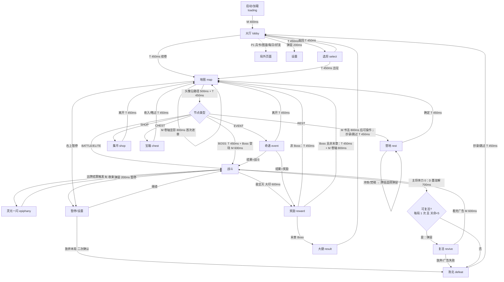

# 《墨卷三国》B 风格页面流程与交互状态

> 配套文档：[render-spec.md](render-spec.md)（组件 §3、动效 §5、安全区 §6、引擎约束 §10、内存 §12）。mockup：`public/mockups/v2/b.html`（战斗）、`public/mockups/v3/*.html`。
> 转场 shader 采用 §12.1 的 7 个程序：**T=泼墨转场**（transition）、**M=蒙版擦出**（mask-reveal）、**H=墨晕命中**（ink-hit）、**D=墨溶解**（dissolve）、**E=灵光墨聚**（epiphany）、**P=后处理 vignette**（post）、**S=卡牌流光**（card-shimmer）。时长均按 1x，受倍速影响，可点屏跳过；**弹层**（暂停/复活/确认）不受倍速影响，不可跳过。

## 1. 流程图

**返回/退出/重进规则**
- **安卓返回键 / 侧滑**：战斗、灵光一闪、响应窗口中会打开“暂停”；地图、节点页中也打开“暂停”（不会直接退回上一页）；选将页返回大厅；大厅中再按一次退出（Toast 提示“再按一次退出”）。
- **切后台**（`wx.onHide`）：战斗自动暂停，响应倒计时冻结；回到前台（`onShow`）后显示暂停弹层，**不自动继续**。
- **断线/杀进程后重进**：每个节点结束时，以及战斗中每回合开始时存档（种子 + 状态）。重进后大厅显示“续卷 · 第 N 章”，进入后回到存档点：战斗恢复到该回合开始；奖励/商店/营地恢复为进入时的状态，**已经生成的候选不重新随机**。
- **放弃本局**：暂停 → 放弃 → 二次确认 → 按败北结算（将魂按 PRD 14.5 折半）。

## 2. 通用交互状态
| 状态 | 视觉 | 时长 |
|---|---|---|
| default | 见 render-spec §3 | — |
| pressed | 缩放 0.96，亮度 .9 | 80ms 按下 / 120ms 抬起 |
| long-press | 按住 0–420ms 显示金色环形进度，到点弹出详情（§3.9）| 420ms |
| disabled | 去饱和（预烘灰度版），α .45；点击给 Toast 或抖动说明原因 | 抖动 160ms |
| selected | 金色外发光环（烘焙贴图）+ 上浮 8–22 | 180ms back |
| empty | 虚线金框槽 + 中央“+”或空状态插画加一句文案 | — |
| loading | 屏中央墨滴旋转（P 程序化），>300ms 才显示，避免闪烁 | — |
| error | 面板 Toast（朱砂描边），给“重试”按钮；网络错误不阻塞离线可玩内容 | 2.5s |

## 3. 逐页交互与边界

### 3.1 大厅 lobby（`v3/lobby.html`）
| 元素 | 状态 |
|---|---|
| 出征 | default/pressed；有存档时出征会弹确认“将覆盖当前进度” |
| 续卷 | 有存档才显示；存档损坏时 disabled 并显示 error Toast |
| 坞栏（兵书/图鉴/每日/好友/设置） | P1 功能未开放时 disabled（α .4）；有新内容时显示朱砂红点 |
| 将魂/天命 | 只显示；长按看说明 |
- 边界：首次进入走新手（PRD 18），出征直接进入脚本首局，不经过选将；未授权好友时“好友”为 disabled。

### 3.2 选将 select（`v3/select.html`）
| 元素 | 状态 |
|---|---|
| 网格武将 ×8 | default / pressed / selected（盖主/副印，α .55）/ long-press（技能详情） |
| 主将槽、副将槽 | empty（虚线 +“点将”）/ filled；点击清空 |
| ⇄ 换位 | 主副都有人时可用，否则 disabled |
| 技能印 | long-press 显示技能详情；主将技为金印，副将技为银印 |
| 兵书带入 | empty（+）/ filled（最多 2 张，天命≥3 时 3 张）；牌组超过 15 张时进入“删到 15”弹层 |
| 墨值格 | 只显示 |
| 天命印 | 点击弹出 0–10 选择；未解锁的等级 disabled |
| 出征 | 主副都选定才可用，此时有 attention 呼吸光；否则 disabled，点击时空槽闪烁 |
- 边界：主副不能同一人（点已是主将的武将，会把该武将移出主将槽）；兵书里没有当前武将可用的牌时显示“无可带兵书”空态；墨值不足不影响带入（墨值只在抄录时消耗）。

### 3.3 地图 map（`v3/map.html`）
| 元素 | 状态 |
|---|---|
| 节点 | done（灰）/ current（头像）/ next（金色脉冲，可点）/ locked（不可点，点了只出类型详情）/ long-press（类型说明） |
| 卷轴 | 可纵向拖动，带惯性和回弹；进入时自动滚到当前层 |
| HUD 宝物/丹药 | long-press 看详情；点丹药弹出“使用？”（地图上只能用非战斗丹药，其余 disabled） |
| 牌组 | 打开牌组列表（只读） |
| 暂停 | 右上，位于胶囊左侧 |
- 边界：只有 1 个可走节点时依然要点击才前进，不自动走；Boss 层显示 Boss 牌，点 Boss 节点前弹出确认（是否已准备好）。

### 3.4 战斗 battle（`v2/b.html`）
| 元素 | 状态 |
|---|---|
| 手牌 | default / selected / dragging / legal / illegal / unaffordable（费用珠变红抖动）/ long-press / ink-ready（流光 S） |
| 敌人牌 | default / targetable（金框）/ untargetable（α .35）/ hit / dying（D）/ long-press |
| 意图 | 攻击/防御/增益/致命/未知(?)；long-press 看具体行动 |
| 倒计时圈 | 数字 = 距行动的出牌次数；为 1 时变朱砂 |
| 虎符 | 满 / 部分 / 空（结束回合按钮出现 attention） |
| 副将牌 | ready（金珠）/ cooldown（数字）/ used（灰） |
| 结束回合 | default / 确认中（“确定？” 1.5s）/ disabled（敌方回合中） |
| 响应弹层 | 合法牌高亮、确定、承受(❤−N)、倒计时 |
| 判定区 | 空时隐藏 / 翻牌 / 结果印 |
- 边界：
  - **没有合法响应**：不弹响应窗口，直接结算伤害，并显示 0.6s 横幅“无闪可出”；“自动出闪”打开且只有 1 张合法牌时自动打出。
  - **手牌满**（上限 10）：抽到的牌飞到弃牌堆并显示“手牌已满”；回合结束超出上限时弹“弃至上限”选择层（刘备“仁义”赠牌也走这个弹层）。
  - **牌堆空**：弃牌堆洗回牌堆，有洗牌动效（300ms）；两边都空时抽牌无效，显示提示。
  - **军令不足**：虎符红闪，牌不进入选中态。
  - **无合法目标**（例如前排全灭、只剩后排）：后排自动视为可选目标（PRD 距离规则）；完全没有目标时卡牌 disabled。
  - 敌人最后一击后立即锁定输入，接大印“胜”。
  - 复活后敌人当前意图改为“闪”（PRD 16.2），意图牌刷新时播 250ms 动画。

### 3.5 灵光一闪 epiphany（`v3/epiphany.html`，新增）
| 元素 | 状态 |
|---|---|
| 词条 ×3 | default / selected / long-press 看完整效果；按稀有度用 N/R/E/L 宝石和框色区分 |
| 铭刻 | 选中词条后才可用 |
| 广告刷新 | 每次灵光 1 次；用过后 disabled；广告失败时冷却 5 分钟后视同观看（PRD 16.3）；loading 时显示墨滴 |
| 次数 1/2 | 只显示（每场最多 2 次） |
- 边界：灵光期间战斗暂停，响应倒计时冻结；不能取消（必须选一个词条）；同一张牌已有同名词条时，该候选不出现。

### 3.6 复活 revive（`v3/revive.html`，新增）
- 元素：复活（广告）/ 放弃。复活按钮在广告 loading 时显示墨滴；广告失败时显示 error 并**不补偿**（PRD 16.3），只剩“放弃”。
- 边界：每局限 1 次，天命≥5 时不弹，直接败北；距离上次广告不足 30s 时按钮倒计时 disabled。

### 3.7 奖励 reward（`v3/reward.html`）
| 元素 | 状态 |
|---|---|
| 3 张卡 | flipping（翻卡中不可点）/ default / selected / long-press |
| 宝物条（精英/Boss） | 可领取 / 已领取（灰）；领取独立于选卡 |
| 战利品胶囊 | 进入时自动入账（数字滚动） |
| 收入 | 选中后可用 |
| 略过 | 二次确认（“放弃本次卡牌？”） |
| 广告刷新 | 每节点 1 次（PRD 16.2；mockup 未画，放在“略过”左侧） |
- 边界：丹药栏满（上限 3）时，丹药胶囊变成“替换/放弃”选择；Boss 奖励至少 1 张 E 以上，外加宝物三选一（复用宝箱布局）。

### 3.8 奇遇 event（`v3/event.html`，新增）
| 元素 | 状态 |
|---|---|
| 选项 | default / selected（再点一次确认）/ disabled（条件不满足：显示“需 X”，即 requiresHero/Gold/Faction）/ long-press 看结果详情 |
| 结果图标 | 结果确定的直接显示，例如 +2❤、−30 铜钱；随机结果显示判定花色或“?” |
- 边界：判定类事件选中后在插画中翻判定牌（650ms），再显示结果面板；结果是战斗时插画用 H 墨晕转入战斗；铜钱不足的选项 disabled 并标红；结果会致死（扣血到 0）时，该选项加朱砂描边并要求二次确认。

### 3.9 营地 rest（`v3/rest.html`，新增）
| 元素 | 状态 |
|---|---|
| 疗伤 | 预览体力增加（待回复的勾玉闪烁）；满血时 disabled |
| 淬炼 | 打开牌组选择，选牌后在牌上展示新词条 |
| 焚稿 | 打开牌组选择；若删后杀类为 0 则不可删，该牌 disabled（PRD 10.4） |
| 第三选项（广告） | 默认只有 2 个选项；第三项要看广告解锁（每章 1 次）；广告失败时 disabled |
| 确定 | 选中后可用 |
- 边界：牌组选择中没有可选牌时（例如牌组全是基础杀，且焚稿受限）显示空态。

### 3.10 集市 shop（`v3/shop.html`）
| 元素 | 状态 |
|---|---|
| 商品 ×7 | default / unaffordable（价签红，点击时抖动）/ sold（灰）/ long-press / 点击后弹出购买确认 |
| 删牌服务 | 打开牌组选择；用后 sold |
| 刷新 25 | 铜钱不足时 disabled |
| 广告刷新 | 每进店 1 次 |
| 离开 | 始终可用 |
- 边界：丹药满时购买丹药会弹出“替换？”；宝物重复的不会出现在货架；刷新后已售格也会补货。

### 3.11 宝箱 chest（`v3/chest.html`，新增）
- 70% 概率：宝物三选一（selected / long-press / 收入 / 略过）。30% 概率：铜钱加一张牌奖励，此时直接跳转奖励页的卡牌布局。
- 边界：宝物池耗尽时以铜钱替代。

### 3.12 结算：大捷 result / 败北 defeat（`v3/result.html`、`v3/defeat.html`）
| 元素 | 状态 |
|---|---|
| 统计 4 项 | 数字依次滚动；long-press 看计算公式 |
| 将魂 ×2（广告） | 每日 3 次；用尽后 disabled 并显示 0/3；广告失败时冷却 |
| 可抄卡 | default / selected / disabled（墨值不足：卡牌抖动，并出现“清理兵书”入口）；没有进化卡时整块显示空态“此卷无灵光” |
| 额外抄录（广告） | 每次结算 1 次，且只能抄墨值 ≤2 的卡 |
| 抄录 / 跳过 | 抄录需选中卡；跳过需二次确认（有可抄卡时） |
- 败北页：整体去饱和；大字用朱砂；左侧显示致命敌人小牌；将魂显示折半前（划线）和折半后的数字。

### 3.13 暂停/设置 settings（`v3/settings.html`，新增）
- 开关和分段控件对应 PRD 19.4：自动出闪、结束回合确认、动画速度、响应时限、高对比手牌，另加震动、画质、音乐/音效。每项改动立即生效并持久化。
- “放弃本局”只在局内显示，需二次确认；从大厅打开时，此处改为“返回大厅”。

## 4. PRD 缺口 / 待确认
1. **复活回 25% 体力**：体力是整数，取整方式未定，mockup 按 8×25%=2 向下取整。另外“清空敌人意图改为闪”的“闪”具体是什么行为，需要说明。
2. **手牌上限**：PRD 没有统一写明，只有郭嘉“遗计 +2”暗示上限存在；mockup 按 10 处理。超限时是抽牌直接进弃牌堆还是回合末弃牌，需要确认。
3. **丹药栏上限**：PRD 未定义（mockup 假设为 3），满了以后获得丹药如何处理也未定。
4. **Boss 战前确认、Boss 登场演出**：PRD 没有，需要确认是否需要。
5. **离线存档粒度**：PRD 17.1 只提到登录与存档，没有规定战斗中能否续玩；本文假设恢复到回合开始。
6. **奖励页广告刷新入口的位置**，以及广告“可跳过”提示文案（PRD 16.1 新手前 2 局）。
7. **营地第三选项（广告）**：PRD 写“二选一 + 广告第三”。默认哪两项、广告解锁哪一项，需要确认（mockup 假设广告解锁焚稿）。
8. **主大厅**、**兵书管理**、**图鉴**、**每日**的具体内容：本 PR 只做了大厅入口，兵书管理页留待下一轮。
9. 词条“无影：不可闪”这类效果的图标语言，需要和策划统一一套状态图标（约 30 个）。

## 5. 新页面对引擎约束与内存的影响
- 新页面复用 `ui_common`、`fx`、`bg_lacquer` 图集，不新增常驻图集。
- **奇遇插画**：20 张，每张 692×584@2x，按次加载（每张 ETC2 约 0.4MB），离开奇遇页即释放，不与战斗图集同时存在。
- 营地篝火、宝箱、商人剪影、大厅主视觉合并成一张 `scene_misc` 图集（2048×1024，ETC2 2MB），按场景加载。
- **灵光一闪、复活**：在战斗内弹出，只用 E/P shader 和现有图集，新增 0MB。
- 所有新页面的峰值都低于战斗峰值（§12.4 中压缩路径 22.4MB）。
- mockup 中的 CSS filter/box-shadow 只是示意，一律按 §10 烘焙。
