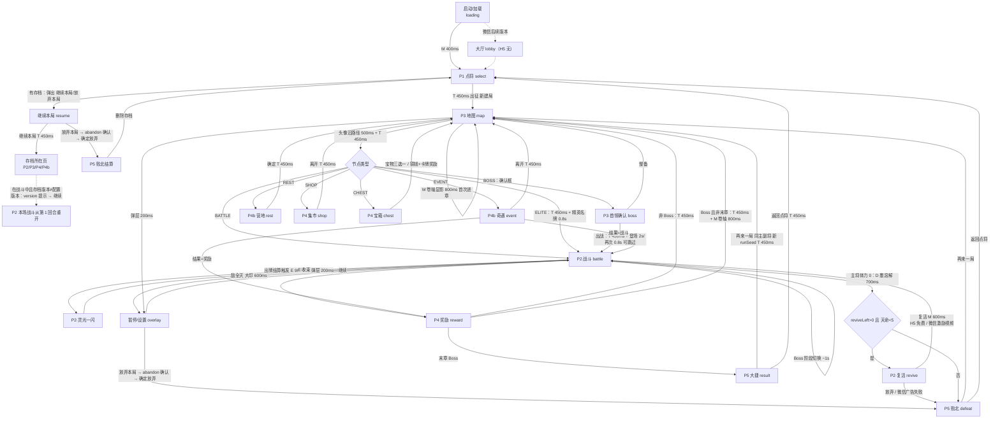

# 《墨卷三国》B 风格页面流程与交互状态

> 配套文档：[render-spec.md](render-spec.md)（组件 §3、动效 §5、安全区 §6、引擎约束 §10、内存 §12）。mockup：`public/mockups/v2/b.html`（战斗）、`public/mockups/v3/*.html`。
> 转场 shader 采用 §12.1 的 7 个程序：**T=泼墨转场**（transition）、**M=蒙版擦出**（mask-reveal）、**H=墨晕命中**（ink-hit）、**D=墨溶解**（dissolve）、**E=灵光墨聚**（epiphany）、**P=后处理 vignette**（post）、**S=卡牌流光**（card-shimmer）。时长均按 1x，受倍速影响，可点屏跳过；**弹层**（暂停/复活/确认）不受倍速影响，不可跳过。

## 0. 页面编号对照（PRD 4.5 ↔ UI）
| PRD 编号 | PRD 名称 | UI 页面 / 状态 | mockup |
|---|---|---|---|
| P1 | 点将 | select（含兵书带入、天命） | `v3/select.html` |
| P2 | 战斗 | battle；**子层**：响应弹层（response）、灵光一闪（epiphany）、复活（revive）、Boss 登场（含阶段演出、精英名牌）、版本更新提示（version，见 §1） | `v2/b.html`、`v3/epiphany.html`、`v3/revive.html` |
| P3 | 地图 | map；**子层**：首领确认（boss confirm）、丹药丢弃（potion discard） | `v3/map.html`、`v3/boss.html` |
| P4 | 奖励 / 集市 / 宝箱 | reward（含丹药满的替换/放弃）、shop、chest（`CHEST` 状态在 P4 上渲染） | `v3/reward.html`（`#full`）、`v3/shop.html`、`v3/chest.html` |
| P4b | 营地 / 奇遇 | rest（H5 三项全开 / 微信 `#wx`）、event | `v3/rest.html`、`v3/event.html` |
| P5 | 结算 | result 大捷 / defeat 败北（含兵书抄录） | `v3/result.html`、`v3/defeat.html` |
| — | （覆盖层） | settings 暂停/设置：覆盖在 P2、P3 之上 |
| — | （启动弹层） | resume 继续本局：有存档时在 P1 上弹出；abandon 放弃本局确认（入口：启动弹窗 / 设置覆盖层） | `v3/resume.html`、`v3/abandon.html` | `v3/settings.html` |
| — | （无编号，H5 不做） | lobby 大厅：仅微信后续版本 | `v3/lobby.html` |

与 PRD 0.5.2 已对齐：P4 更名“奖励/集市/宝箱”，CHEST 在 P4 上渲染；子层和覆盖层的划分与 PRD 一致；大厅仅保留给微信版。

## 1. 流程图

**返回/退出/重进规则**
- **安卓返回键 / 侧滑**：战斗、灵光一闪、响应窗口中会打开“暂停”；地图、节点页中也打开“暂停”（不会直接退回上一页）；选将页返回大厅；大厅中再按一次退出（Toast 提示“再按一次退出”）。
- **切后台**（`wx.onHide`）：战斗自动暂停，响应倒计时冻结；回到前台（`onShow`）后显示暂停弹层，**不自动继续**。
- **断线/杀进程后重进（PRD 21.4）**：每次结算完成、进入下一个决策点时自动存档；重进后恢复到**最近一个决策点**（例如刚出完一张牌后），**不是回合开始**，也不能回退。奖励/商店/营地恢复为已生成的候选，不重新随机。**版本不一致（PRD 0.5.2 / 0.5.4）**：①存档停在战斗中时，**本场战斗从头开始**（使用进入本场战斗前的体力、牌组、铜钱、地图路线），并弹出 `version` 对话框（`v3/version.html`），文案必须**一字不差**：「游戏已更新。为保证规则一致，本场战斗将从头开始；进入本场战斗前的进度（体力、牌组、铜钱、地图路线）均已保留。」，只有一个按钮「继续」，点击后本场战斗**从第 1 回合重新开始**（重新洗牌、敌人回满、回合数归 1）；②不在战斗中时，**静默**用新配置继续，不弹任何提示。进战斗节点时先写盘再播动画。
- **H5 启动**：直接进 P1 点将。有存档时先在 P1 上弹 `resume` 对话框「继续本局？」，显示主副将、章节/层、体力、铜钱、牌组张数、天命，按钮「继续本局」/「放弃本局」。放弃本局的流程见下一条。**原先的“续卷”入口已删除。**
- **放弃本局（PRD 0.5.4 / 1.1.1）**：有两个入口，①启动弹窗「放弃本局」，②设置覆盖层（P2/P3 暂停）「放弃本局」。两者都打开同一个 `abandon` 确认框（`v3/abandon.html`），文案必须**一字不差**：「放弃后本局按失败结算，将魂减半，存档将被删除。确定放弃？」；按钮「确定放弃」（朱砂色，右侧）/「返回」（左侧）。
  - 返回：关闭确认框，回到入口所在的弹窗或覆盖层。
  - 确定放弃：进入 **P5 败北结算页**（将魂减半，PRD 14.5），离开结算页时**才删除存档**，然后回到 P1。结算页展示前若进程被杀，下次启动仍会弹「继续本局」。
- **结算出口（PRD 4.5 / 14.5）**：P5 只有「再来一局」（同主副将，新 runSeed，直接进 P3）和「返回点将」（P1）。**H5 没有大厅**，启动后直接进入 P1。

## 2. 通用交互状态
| 状态 | 视觉 | 时长 |
|---|---|---|
| default | 见 render-spec §3 | — |
| pressed | 缩放 0.96，亮度 .9 | 80ms 按下 / 120ms 抬起 |
| long-press | 按住 0–420ms 显示金色环形进度，到点弹出详情（§3.9）| 420ms |
| disabled | 去饱和（预烘灰度版），α .45；点击给 Toast 或抖动说明原因 | 抖动 160ms |
| selected | 金色外发光环（烘焙贴图）+ 上浮 8–22 | 180ms back |
| empty | 虚线金框槽 + 中央“+”或空状态插画加一句文案 | — |
| loading | 屏中央墨滴旋转（P 程序化），>300ms 才显示，避免闪烁 | — |
| error | 面板 Toast（朱砂描边），给“重试”按钮；网络错误不阻塞离线可玩内容 | 2.5s |

## 3. 逐页交互与边界

### 3.1 大厅 lobby（`v3/lobby.html`，**H5 不实现**，仅微信后续版本）
- H5 启动后直接进入 P1 点将；有存档时弹出“继续本局 / 放弃”（见 §1）。
- 微信版大厅：出征、续卷；坞栏的兵书/图鉴/每日/好友**本轮隐藏**（PRD 19.1.1，转 25.3 待办），只保留“设置”。

### 3.2 选将 select（`v3/select.html`）
| 元素 | 状态 |
|---|---|
| 网格武将 ×8 | default / pressed / selected（盖主/副印，α .55）/ long-press（技能详情） |
| 主将槽、副将槽 | empty（虚线 +“点将”）/ filled；点击清空 |
| ⇄ 换位 | 主副都有人时可用，否则 disabled |
| 技能印 | long-press 显示技能详情；主将技为金印，副将技为银印 |
| 兵书带入 | empty（+）/ filled（最多 2 张，天命≥3 时 3 张）；牌组超过 15 张时进入“删到 15”弹层 |
| 墨值格 | 只显示 |
| 天命印 | 点击弹出 0–10 选择；未解锁的等级 disabled |
| 出征 | 主副都选定才可用，此时有 attention 呼吸光；否则 disabled，点击时空槽闪烁 |
- 边界：主副不能同一人（点已是主将的武将，会把该武将移出主将槽）；兵书里没有当前武将可用的牌时显示“无可带兵书”空态；墨值不足不影响带入（墨值只在抄录时消耗）。

### 3.3 地图 map（`v3/map.html`）
| 元素 | 状态 |
|---|---|
| 节点 | done（灰）/ current（头像）/ next（金色脉冲，可点）/ locked（不可点，点了只出类型详情）/ long-press（类型说明） |
| 卷轴 | 可纵向拖动，带惯性和回弹；进入时自动滚到当前层 |
| HUD 宝物/丹药 | long-press 看详情；点丹药弹出“使用 / 丢弃”（地图上只能使用非战斗丹药；**丢弃**任何丹药都可以，用于腾格，需二次确认） |
| 牌组 | 打开牌组列表（只读） |
| 暂停 | 右上，位于胶囊左侧 |
- 边界：只有 1 个可走节点时依然要点击才前进，不自动走。Boss 名称和头像开局可见。点 Boss 节点弹出**首领确认框**（`v3/boss.html`）“进入首领战？（之后无法返回）”，显示当前体力和丹药，按钮为「整备」（返回地图，可先丢弃丹药）/「出战」。精英节点不弹确认。

### 3.4 战斗 battle（`v2/b.html`）
| 元素 | 状态 |
|---|---|
| 手牌 | default / selected / dragging / legal / illegal / unaffordable（费用珠变红抖动）/ long-press / ink-ready（流光 S） |
| 敌人牌 | default / targetable（金框）/ untargetable（α .35）/ hit / dying（D）/ long-press |
| 意图 | 攻击/防御/增益/致命/未知(?)；long-press 看具体行动 |
| 倒计时圈 | 数字 = 距行动的出牌次数；为 1 时变朱砂 |
| 虎符 | 满 / 部分 / 空（结束回合按钮出现 attention） |
| 副将牌 | ready（金珠）/ cooldown（数字）/ used（灰） |
| 结束回合 | default / 确认中（“确定？” 1.5s）/ disabled（敌方回合中） |
| 响应弹层 | 合法牌高亮、确定、承受(❤−N)、倒计时 |
| 判定区 | 空时隐藏 / 翻牌 / 结果印 |
- 边界：
  - **没有合法响应**：不弹响应窗口，直接结算伤害，并显示 0.6s 横幅“无闪可出”；“自动出闪”打开且只有 1 张合法牌时自动打出。
  - **手牌（PRD 5.4）**：回合结束弃到 `max(2, 当前体力)` + 技能修正（例如郭嘉 +2），超出时弹“弃至上限”选择层（刘备“仁义”赠牌也走这个弹层）。**任意时刻硬上限 10（PRD 0.5.4 已定稿，不再待定）**：超出的牌直接飞进弃牌堆，显示 Toast“手满，弃置”，**不触发任何弃牌效果**。
  - **牌堆空**：弃牌堆洗回牌堆，有洗牌动效（300ms）；两边都空时抽牌无效，显示提示。
  - **军令不足**：虎符红闪，牌不进入选中态。
  - **无合法目标**（例如前排全灭、只剩后排）：后排自动视为可选目标（PRD 距离规则）；完全没有目标时卡牌 disabled。
  - 敌人最后一击后立即锁定输入，接大印“胜”。
  - **复活后（PRD 4.4）**：如果复活发生在敌方回合，本回合尚未结算的敌方出牌全部取消（被取消的牌化墨淡出，300ms）；意图栏立即刷新为 `flash_mark` 闪意图（250ms）。下一个敌方回合所有敌人只出闪（各 +1 闪标记，上限 2），之后从被替换前的意图继续循环。
  - **Boss（PRD 10.9）**：登场演出约 2s（名牌 + 一句台词），点击可跳过，同一 Boss 第 2 次起缩短为 0.8s；阶段切换演出约 1s；精英进入时显示 0.8s 名牌。演出期间锁定输入。

### 3.5 灵光一闪 epiphany（`v3/epiphany.html`，新增）
| 元素 | 状态 |
|---|---|
| 词条 ×3 | default / selected / long-press 看完整效果；按稀有度用 N/R/E/L 宝石和框色区分 |
| 铭刻 | 选中词条后才可用 |
| 广告刷新 | 每次灵光 1 次；用过后 disabled；广告失败时冷却 5 分钟后视同观看（PRD 16.3）；loading 时显示墨滴 |
| 次数 1/2 | 只显示（每场最多 2 次） |
- 边界：灵光期间战斗暂停，响应倒计时冻结；该牌词条少于 2 条时不能取消（必须选一个词条），已有 2 条时可替换或「放弃」（PRD 8.6）；同一张牌已有同名词条时，该候选不出现。H5 不显示广告刷新按钮。

### 3.6 复活 revive（P2 子层，`v3/revive.html`）
- 元素：主将灰度牌、标题“将星未陨”、收益行（+N❤，N = `max(2, ceil(最大体力×25%))`；+3 护甲）、“敌下回合”行（每个敌人一个闪意图 +1）、按钮「复活」/「放弃」、次数“本局 1 次”。
- H5：复活免费，每局 1 次（O25 已结案）。微信：按钮带 ▶ 激励视频；广告 loading 时显示墨滴；失败**不补偿**，只剩“放弃”；距离上次广告不足 30s 时按钮倒计时 disabled。
- 边界：天命≥5 或 `reviveLeft=0` 时不弹，直接进 P5 败北。

### 3.7 奖励 reward（`v3/reward.html`）
| 元素 | 状态 |
|---|---|
| 3 张卡 | flipping（翻卡中不可点）/ default / selected / long-press |
| 宝物条（精英/Boss） | 可领取 / 已领取（灰）；领取独立于选卡 |
| 战利品胶囊 | 进入时自动入账（数字滚动） |
| 收入 | 选中后可用 |
| 略过 | 二次确认（“放弃本次卡牌？”） |
| 刷新（PRD 16.2.1） | 位于候选卡下方、「略过」左侧。H5：「免费刷新（本局 1 次）」，用 `freeRefreshUsed` 记录；微信：「▶ 刷新」每节点 1 次。用完置灰；新手前 2 局按钮旁显示气泡“看一段视频即可获得，不看也不影响进度”（每个点位只显示一次，仅微信） |
- 边界：**丹药栏 3 格（PRD 12.2）**：满了以后丹药胶囊标“3/3”，领取时弹出“丹药已满”层（`#full`），选择替换哪一格或放弃；Boss 奖励至少 1 张 E 以上，外加宝物三选一（复用宝箱布局）。

### 3.8 奇遇 event（`v3/event.html`，新增）
| 元素 | 状态 |
|---|---|
| 选项 | default / selected（再点一次确认）/ disabled（条件不满足：显示“需 X”，即 requiresHero/Gold/Faction）/ long-press 看结果详情 |
| 结果图标 | 结果确定的直接显示，例如 +2❤、−30 铜钱；随机结果显示判定花色或“?” |
- 边界：判定类事件选中后在插画中翻判定牌（650ms），再显示结果面板；结果是战斗时插画用 H 墨晕转入战斗；铜钱不足的选项 disabled 并标红；结果会致死（扣血到 0）时，该选项加朱砂描边并要求二次确认。

### 3.9 营地 rest（`v3/rest.html`，新增）
| 元素 | 状态 |
|---|---|
| 疗伤 | 预览体力增加（待回复的勾玉闪烁）；满血时 disabled |
| 淬炼 | 打开牌组选择，选牌后在牌上展示新词条 |
| 焚稿 | 打开牌组选择；若删后杀类为 0 则不可删，该牌 disabled（PRD 10.4） |
| 焚稿的开放方式（PRD 10.6/16.2.1） | **H5：三项都开放**；**微信**（`#wx`）：默认开放疗伤、淬炼，焚稿需激励视频解锁（每章 1 次），新手前 2 局显示提示气泡；广告失败时 disabled |
| 确定 | 选中后可用 |
- 边界：牌组选择中没有可选牌时（例如牌组全是基础杀，且焚稿受限）显示空态。

### 3.10 集市 shop（`v3/shop.html`）
| 元素 | 状态 |
|---|---|
| 商品 ×8（5 卡 + 1 宝物 + 2 丹药；对齐 PRD §10.7） | default / unaffordable（价签红，点击时抖动）/ sold（灰）/ long-press / 点击后弹出购买确认 |
| 删牌服务 | 打开牌组选择；用后 sold |
| 刷新 25 | 铜钱不足时 disabled |
| 广告刷新 | 每进店 1 次 |
| 离开 | 始终可用 |
- 边界：**丹药满时不能购买丹药**（价签灰，点击提示 Toast“丹药已满”，PRD 12.2）；宝物重复的不会出现在货架；刷新后已售格也会补货。

### 3.11 宝箱 chest（`v3/chest.html`，新增）
- **75%** 概率：宝物三选一（selected / long-press / 收入 / 略过）。**25%** 概率：铜钱 50–80 + 一张牌奖励，此时直接跳转奖励页的卡牌布局。（对齐 PRD §10.8）
- 边界：宝物池耗尽时以铜钱替代。

### 3.12 结算：大捷 result / 败北 defeat（`v3/result.html`、`v3/defeat.html`）
| 元素 | 状态 |
|---|---|
| 统计 4 项 | 数字依次滚动；long-press 看计算公式 |
| 将魂 | 逐行明细（PRD 14.5）+ 累计将魂；**H5 没有翻倍**；微信版 ▶×2 每日 3 次 |
| 可抄卡 | default / selected / disabled（墨值不足：卡牌抖动，并出现“清理兵书”入口）；没有进化卡时整块显示空态“此卷无灵光” |
| 额外抄录（广告） | 每次结算 1 次，且只能抄墨值 ≤2 的卡 |
| 兵书抄录区 | 可跳过；选中卡后点“抄录”（区内按钮）执行 |
| 底栏 | 「返回点将」(P1) /「再来一局」(P3，同主副将、新 runSeed)；有未抄录的进化卡时，离开前二次确认 |
- 败北页：整体去饱和；大字用朱砂；左侧显示致命敌人小牌；将魂显示折半前（划线）和折半后的数字。

### 3.13 暂停/设置 settings（`v3/settings.html`，新增）
- 开关和分段控件对应 PRD 19.4：自动出闪、结束回合确认、动画速度、响应时限、高对比手牌，另加震动、画质、音乐/音效。每项改动立即生效并持久化。
- “放弃本局”只在局内显示，需二次确认；从大厅打开时，此处改为“返回大厅”。

## 4. PRD 缺口：已由 PRD 0.5 结案
| # | 问题 | 结论（PRD 章节） |
|---|---|---|
| 1 | 复活取整与“意图改闪” | `max(2, ceil(最大体力×25%))` +3 护甲；敌方回合中复活则取消剩余出牌，下一敌方回合全员出闪（+1 闪标记），之后从原意图继续（4.4） |
| 2 | 手牌上限（已定稿） | 回合末弃到 `max(2,体力)`+技能修正；任意时刻硬上限 10，溢出直接进弃牌堆，Toast“手满，弃置”，不触发弃牌效果（5.4） |
| 3 | 丹药栏 | 3 格；奖励页替换/放弃，集市不能买，地图可丢弃（12.2） |
| 4 | Boss 确认与演出（0.5.2：子层归属 P2/P3） | 确认框（整备/出战）；登场 2s 可跳过、第 2 次起 0.8s；阶段切换 1s；精英名牌 0.8s（10.9） |
| 5 | 续玩粒度 | 恢复到最近决策点；版本不一致回到战前（21.4） |
| 6 | 奖励刷新入口与文案 | 卡下方、略过左侧；H5“免费刷新（本局 1 次）”/微信“▶ 刷新”；新手气泡（16.2.1） |
| 7 | 营地第三项 | 微信默认疗伤+淬炼，广告解锁焚稿；H5 三项全开（10.6、16.2.1） |
| 8 | 局外页 | 兵书管理/图鉴/每日本轮 H5 不做（19.1.1） |
| 9 | 图标 | 统一图标 id 表（19.1.2），UI 对照见 render-spec §14 |

**仍待决策**（PRD 标【待用户决策】）：H5 复活是否免费（UI 按免费出稿）；存档版本不一致时回战前的提示文案。

## 5. 新页面对引擎约束与内存的影响
- 新页面复用 `ui_common`、`fx`、`bg_lacquer` 图集，不新增常驻图集。
- **奇遇插画**：20 张，每张 692×584@2x，按次加载（每张 ETC2 约 0.4MB），离开奇遇页即释放，不与战斗图集同时存在。
- 营地篝火、宝箱、商人剪影、大厅主视觉合并成一张 `scene_misc` 图集（2048×1024，ETC2 2MB），按场景加载。
- **灵光一闪、复活**：在战斗内弹出，只用 E/P shader 和现有图集，新增 0MB。
- 所有新页面的峰值都低于战斗峰值（§12.4 中压缩路径 22.4MB）。
- mockup 中的 CSS filter/box-shadow 只是示意，一律按 §10 烘焙。
